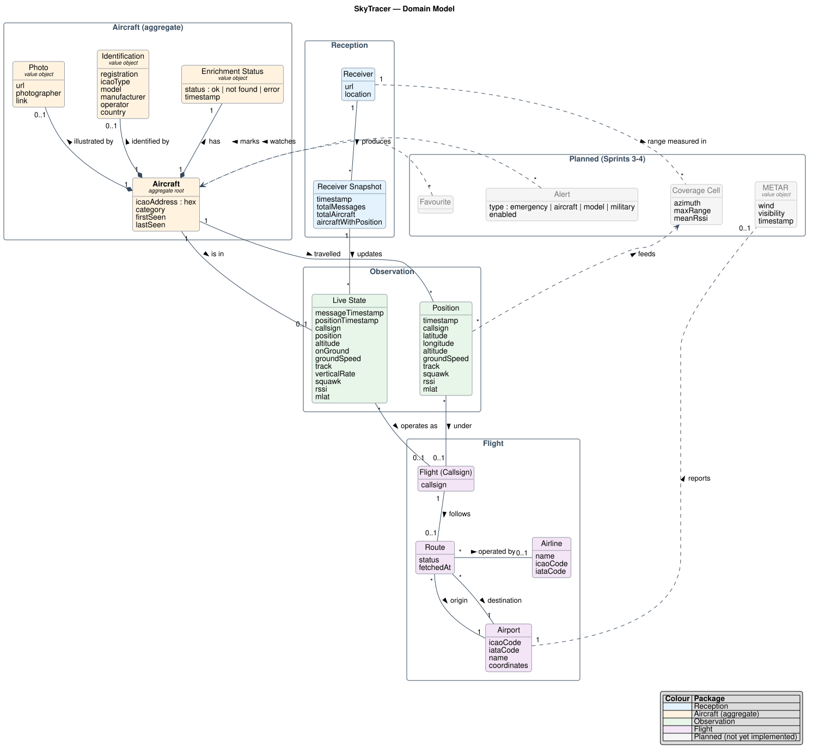
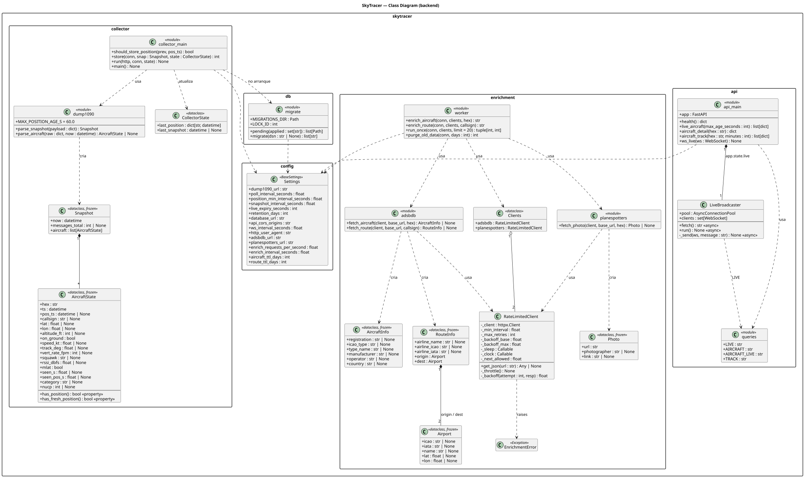

# Global Artefacts

| Artefact | Contents |
|---|---|
| [Glossary](glossary.md) | Domain terms, expressions and acronyms |
| [Supplementary Specification (FURPS+)](furps.md) | Non-functional requirements and constraints |
| [Domain Model](#1-domain-model-dm) | Conceptual model of the problem |
| [Class Diagram](#2-class-diagram-cd) | Backend classes and modules, as implemented |

## 1. Domain Model (DM)

Conceptual model of the problem: concepts, attributes and associations, independent of technology.
Concepts are grouped by package and colour; grey concepts belong to user stories that have not yet been implemented.

Notes:

- **Aircraft** is the aggregate root: identification, photo and enrichment status only exist in association with an aircraft and are refreshed together.
- **Live State** and **Position** differ in purpose: the former is the latest observation (replaced on every read); the latter is historical (accumulated and subject to retention).
- **Route** is associated with the **Flight (Callsign)**, not with the aircraft, since the same aircraft operates several flights per day.

## 2. Class Diagram (CD)

Backend classes and modules (`backend/src/`, TypeScript), with their attributes, operations and dependencies, as implemented.
Modules containing only functions are shown with the `<<module>>` stereotype and TypeScript interfaces with `<<interface>>`.

Notes:

- **From DM to CD:** domain concepts are not persistent classes (no ORM is used); they exist as PostgreSQL tables in Supabase and as plain interfaces that carry data between layers (`AircraftState`, `LiveAircraft`, `AircraftInfo`, `RouteInfo`, `Photo`). The **Live State** exists only in memory (`Collector.live`).
- **`Tracker`** (Durable Object) is the single always-on component: it owns the `Collector`, the `Enricher` and the `Supabase` client, runs the loop in `alarm()` and answers the API in `fetch()`.
- **Parsing separated from I/O:** `dump1090`, `adsbdb` and `planespotters` convert JSON into objects without side effects; external HTTP access is isolated in `ApiGate` and database access in `Supabase`.
- **`Config`** is the single source of configuration, built from the Worker variables and secrets by `loadConfig`.
