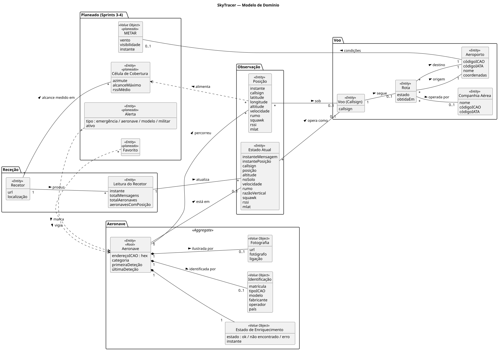
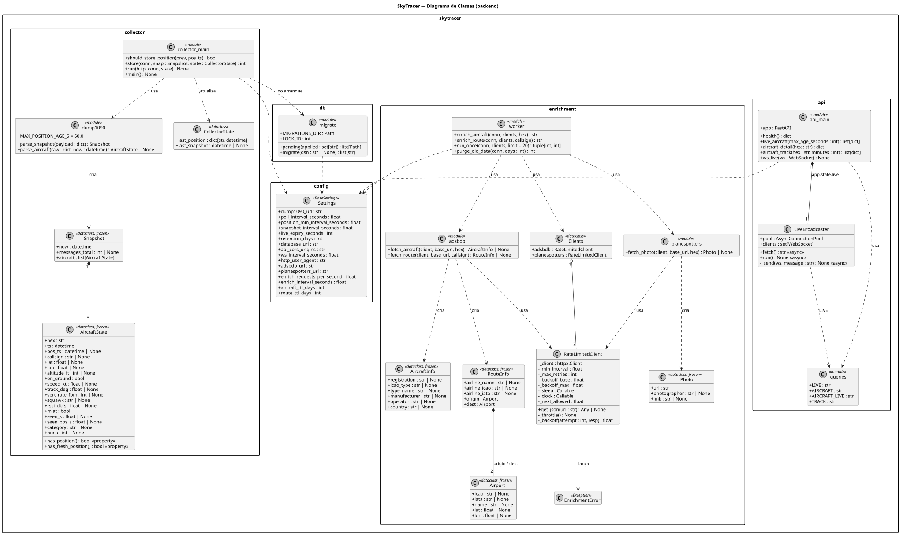

# Artefactos globais

## 1. [Glossário](glossary.md)

## 2. Modelo de Domínio (DM)

Modelo conceptual do problema: conceitos, atributos e associações, independente da tecnologia.
Os conceitos marcados `<<planeado>>` pertencem a user stories ainda não implementadas.

Notas:

- **Aeronave** é a raiz do agregado: a identificação, a fotografia e o estado de enriquecimento só existem associados a uma aeronave e são renovados em conjunto.
- **Estado Atual** e **Posição** distinguem-se pelo propósito: o primeiro é a última observação (substituída a cada leitura); a segunda é histórica (acumulada e sujeita a retenção).
- **Rota** está associada ao **Voo (Callsign)** e não à aeronave: a mesma aeronave opera vários voos por dia.

## 3. Diagrama de Classes (CD)

Classes e módulos do backend (`backend/skytracer/`), com atributos, operações e dependências, tal como estão implementados.
Os módulos Python que só contêm funções aparecem com o estereótipo `<<module>>`.

Notas:

- **Do DM para o CD:** os conceitos do domínio não são classes persistentes (não há ORM); vivem como tabelas no PostgreSQL e como *dataclasses* imutáveis que transportam dados entre camadas (`AircraftState`, `AircraftInfo`, `RouteInfo`, `Photo`).
- **Parsing separado de I/O:** `dump1090`, `adsbdb` e `planespotters` convertem JSON em objetos sem efeitos laterais; a rede está isolada em `RateLimitedClient` e a BD nos módulos de serviço (`collector_main`, `worker`, `api_main`).
- **`Settings`** é a única fonte de configuração, partilhada por todos os serviços.
