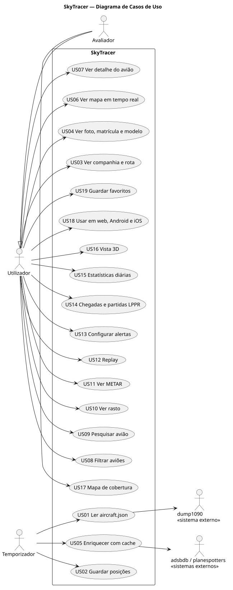

# Casos de Uso

Cada user story tem uma pasta própria com `README.md` (story, critérios de aceitação, cenários, justificação do desenho) e os diagramas em `puml/` (fonte PlantUML) e `svg/` (gerados).

- **SSD** — Diagrama de Sequência do Sistema: o sistema como caixa negra, apenas as interações com os atores.
- **SD** — Diagrama de Sequência: o interior do sistema (módulos, funções, BD) tal como está implementado.

## Diagrama de Casos de Uso

## User stories

Estado: ✅ feito · 🟡 backend feito, falta a app · ⏳ planeado

| US | Título | Sprint | Estado | SSD | SD |
|---|---|---|---|---|---|
| [US01](US01/README.md) | Ler o aircraft.json | 1 | ✅ | ✓ | ✓ |
| [US02](US02/README.md) | Guardar posições | 1 | ✅ | ✓ | ✓ |
| [US03](US03/README.md) | Companhia e rota | 1–2 | 🟡 | ✓ | ✓ |
| [US04](US04/README.md) | Foto, matrícula e modelo | 1–2 | 🟡 | ✓ | ✓ |
| [US05](US05/README.md) | Cache do enriquecimento | 1 | ✅ | ✓ | ✓ |
| [US06](US06/README.md) | Mapa em tempo real | 1–2 | 🟡 | ✓ | ✓ |
| [US07](US07/README.md) | Painel de detalhe | 1–2 | 🟡 | ✓ | ✓ |
| [US08](US08/README.md) | Filtrar aviões | 2 | ⏳ | ✓ | — |
| [US09](US09/README.md) | Pesquisar avião | 2 | ⏳ | ✓ | — |
| [US10](US10/README.md) | Rasto | 1–2 | 🟡 | ✓ | ✓ |
| [US11](US11/README.md) | METAR | 4 | ⏳ | ✓ | — |
| [US12](US12/README.md) | Replay | 3 | ⏳ | ✓ | — |
| [US13](US13/README.md) | Alertas | 3 | ⏳ | ✓ | — |
| [US14](US14/README.md) | Chegadas e partidas LPPR | 4 | ⏳ | ✓ | — |
| [US15](US15/README.md) | Estatísticas diárias | 4 | ⏳ | ✓ | — |
| [US16](US16/README.md) | Vista 3D | 4 | ⏳ | ✓ | — |
| [US17](US17/README.md) | Mapa de cobertura | 3 | ⏳ | ✓ | — |
| [US18](US18/README.md) | Multiplataforma | 3 | ⏳ | — | — |
| [US19](US19/README.md) | Favoritos | 4 | ⏳ | ✓ | — |
