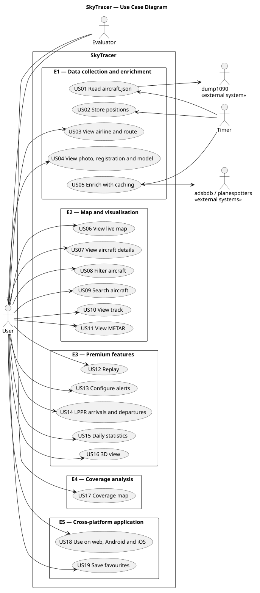

# Use Cases

Each user story has its own folder containing a `README.md` (story, acceptance criteria, scenarios and design rationale) and its diagrams in `puml/` (PlantUML source) and `svg/` (generated).

- **SSD** — System Sequence Diagram: the system as a black box, showing only its interactions with the actors.
- **SD** — Sequence Diagram: the internals of the system (modules, functions, database) as implemented.

## Use Case Diagram

## User Stories

Status: ✅ done · 🟡 backend done, application pending · ⏳ planned

| US | Title | Sprint | Status | SSD | SD |
|---|---|---|---|---|---|
| [US01](US01/README.md) | Read aircraft.json | 1 | ✅ | ✓ | ✓ |
| [US02](US02/README.md) | Store positions | 1 | ✅ | ✓ | ✓ |
| [US03](US03/README.md) | Airline and route | 1–2 | 🟡 | ✓ | ✓ |
| [US04](US04/README.md) | Photo, registration and model | 1–2 | 🟡 | ✓ | ✓ |
| [US05](US05/README.md) | Enrichment caching | 1 | ✅ | ✓ | ✓ |
| [US06](US06/README.md) | Real-time map | 1–2 | 🟡 | ✓ | ✓ |
| [US07](US07/README.md) | Details panel | 1–2 | 🟡 | ✓ | ✓ |
| [US08](US08/README.md) | Filter aircraft | 2 | ⏳ | ✓ | — |
| [US09](US09/README.md) | Search aircraft | 2 | ⏳ | ✓ | — |
| [US10](US10/README.md) | Track | 1–2 | 🟡 | ✓ | ✓ |
| [US11](US11/README.md) | METAR | 4 | ⏳ | ✓ | — |
| [US12](US12/README.md) | Replay | 3 | ⏳ | ✓ | — |
| [US13](US13/README.md) | Alerts | 3 | ⏳ | ✓ | — |
| [US14](US14/README.md) | LPPR arrivals and departures | 4 | ⏳ | ✓ | — |
| [US15](US15/README.md) | Daily statistics | 4 | ⏳ | ✓ | — |
| [US16](US16/README.md) | 3D view | 4 | ⏳ | ✓ | — |
| [US17](US17/README.md) | Coverage map | 3 | ⏳ | ✓ | — |
| [US18](US18/README.md) | Cross-platform | 3 | ⏳ | — | — |
| [US19](US19/README.md) | Favourites | 4 | ⏳ | ✓ | — |
