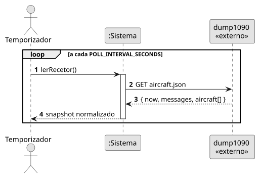
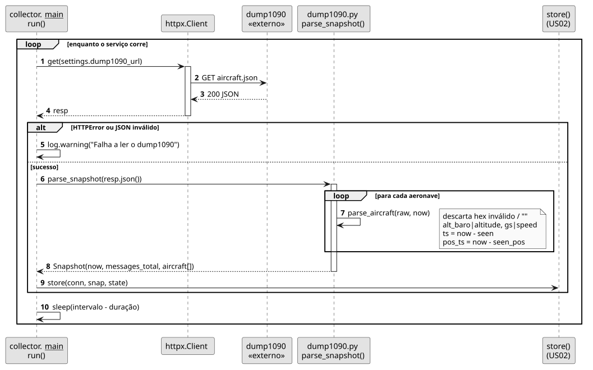

# US01 — Ler o aircraft.json do dump1090

**Épico:** E1 · **Prioridade:** M · **SP:** 3 · **Estado:** ✅ Sprint 1

## User Story

> Como sistema, quero ler o `aircraft.json` do dump1090 a cada segundo para ter as posições atualizadas.

## Critérios de Aceitação

- O collector lê o `aircraft.json` a cada `POLL_INTERVAL_SECONDS` (1 s).
- Aceita os campos do dump1090-mutability (`altitude`, `speed`, `vert_rate`) e do dump1090-fa (`alt_baro`, `gs`, `baro_rate`).
- Se a leitura falhar, regista o erro e tenta de novo na iteração seguinte, sem terminar.
- A hora da posição é calculada a partir de `seen_pos`; posições com mais de 60 s não são consideradas atuais.
- Endereços não-ICAO (prefixo `~`, TIS-B) são ignorados.

## Pré-condições

- O recetor `https://ads-b.jcboliveira.xyz/dump1090/data/aircraft.json` está acessível.

## Pós-condições

- É produzido um `Snapshot` normalizado com uma lista de `AircraftState`, entregue à US02 para persistência.

## Cenário Principal

1. O temporizador desencadeia uma nova leitura.
2. O sistema pede o `aircraft.json` ao dump1090.
3. O sistema normaliza cada aeronave (nomes de campos, instantes absolutos, altitude/solo).
4. O sistema entrega o snapshot à persistência (US02) e aguarda até ao próximo ciclo.

## Fluxos Alternativos / Exceções

| Passo | Condição | Resposta do sistema |
|---|---|---|
| 2 | Erro de rede, *timeout* ou HTTP ≠ 2xx | Regista *warning* e tenta no ciclo seguinte |
| 3 | JSON inválido | Regista *warning* e tenta no ciclo seguinte |
| 3 | `hex` inválido ou não-ICAO | A aeronave é descartada |

## Justificação do Desenho

- `dump1090.py` usa apenas a biblioteca padrão e funções puras (`parse_snapshot`, `parse_aircraft`), o que permite testá-lo sem rede nem BD (`tests/test_dump1090.py`).
- Os instantes são calculados como `now − seen` / `now − seen_pos`, usando o `now` do próprio recetor, para não gravar a mesma posição antiga com horas diferentes.
- O ciclo compensa o tempo gasto (`sleep(intervalo − duração)`) para manter a frequência de 1 Hz.

## Diagramas

- [SSD](puml/ssd_us01.puml) · 
- [SD](puml/sd_us01.puml) · 
