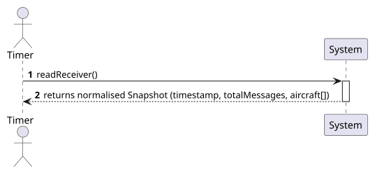
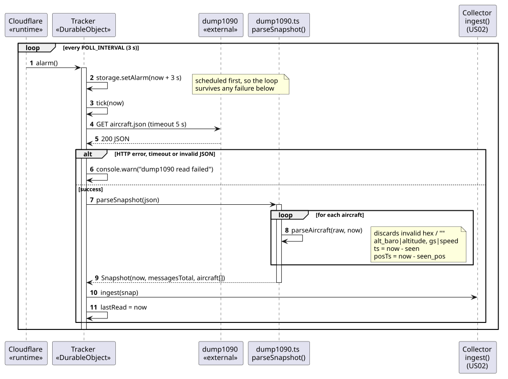

# US01 — Read aircraft.json from dump1090

**Epic:** E1 · **Priority:** M · **SP:** 3 · **Status:** ✅ Sprint 1

## User Story

> As the system, I want to read `aircraft.json` from dump1090 every few seconds so that I have up-to-date positions.

## Acceptance Criteria

- The system reads `aircraft.json` every 3 s (alarm of the `Tracker` Durable Object).
- Accepts fields from dump1090-mutability (`altitude`, `speed`, `vert_rate`) and dump1090-fa (`alt_baro`, `gs`, `baro_rate`).
- If reading fails, it logs the error and retries on the next iteration without terminating.
- Position timestamp is calculated from `seen_pos`; positions older than 60 s are not considered current.
- Non-ICAO addresses (prefix `~`, TIS-B) are ignored.

## Preconditions

- The receiver `https://ads-b.jcboliveira.xyz/dump1090/data/aircraft.json` is accessible.

## Postconditions

- A normalised `Snapshot` is produced containing a list of `AircraftState`, handed over to US02 for persistence.

## Main Success Scenario

1. The Durable Object alarm triggers a new read and schedules the next one.
2. The system requests `aircraft.json` from dump1090.
3. The system normalises each aircraft (field names, absolute timestamps, altitude/ground).
4. The system hands over the snapshot to the collector (US02) and waits for the next alarm.

## Alternative Flows / Exceptions

| Step | Condition | System response |
|---|---|---|
| 2 | Network error, timeout, or HTTP ≠ 2xx | Logs a warning and retries on the next cycle |
| 3 | Invalid JSON | Logs a warning and retries on the next cycle |
| 3 | Invalid or non-ICAO `hex` | The aircraft is discarded |

## Design Rationale

- `dump1090.ts` contains only pure functions (`parseSnapshot`, `parseAircraft`), allowing it to be tested without network or database (`test/dump1090.test.ts`).
- Timestamps are calculated as `now − seen` / `now − seen_pos`, using the receiver's own `now`, to avoid saving the same old position with different timestamps.
- The next alarm is scheduled **before** the read, so the loop survives any failure in the iteration.
- The 3 s interval keeps the Cloudflare free plan within its daily limits (one Durable Object request and one storage write per alarm, about 29,000 per day out of 100,000).

## Diagrams

- [SSD](puml/ssd_us01.puml) · 
- [SD](puml/sd_us01.puml) · 
