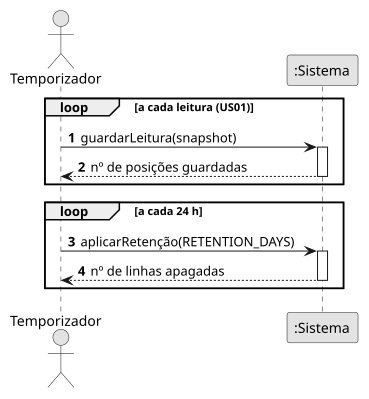
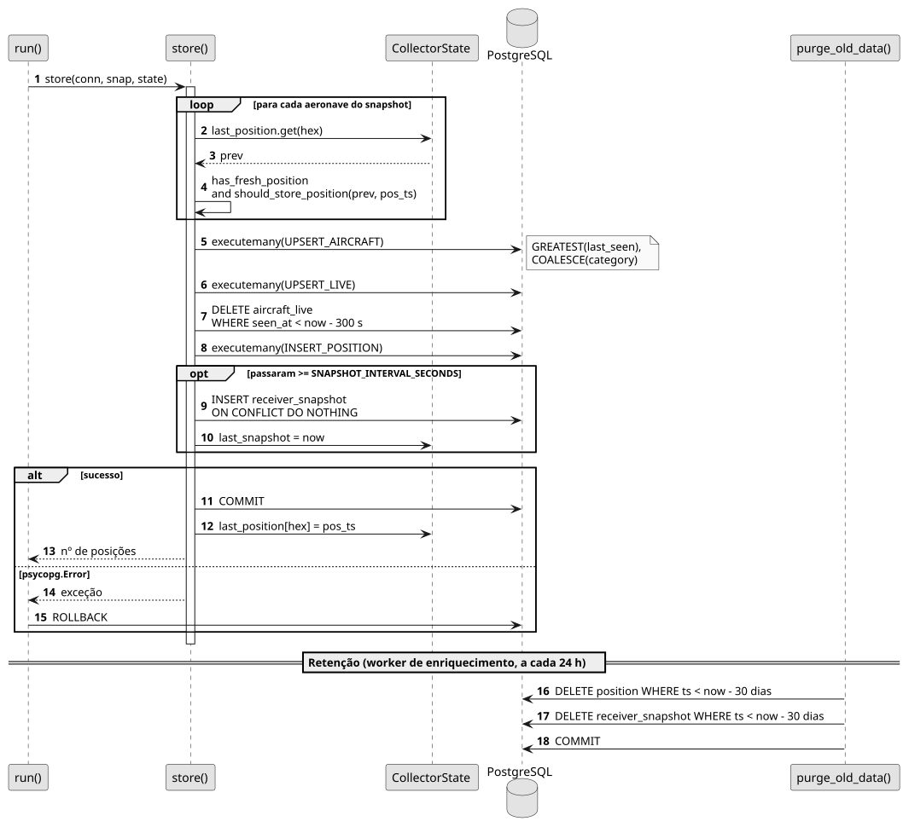

# US02 — Guardar as posições em PostgreSQL

**Épico:** E1 · **Prioridade:** M · **SP:** 5 · **Estado:** ✅ Sprint 1

## User Story

> Como sistema, quero guardar cada posição em PostgreSQL para manter o histórico dos voos.

## Critérios de Aceitação

- Cada aeronave vista fica na tabela `aircraft` com `first_seen` / `last_seen`.
- A posição de cada aeronave é guardada no máximo a cada `POSITION_MIN_INTERVAL_SECONDS` (5 s).
- Aeronaves sem posição, ou com posição com mais de 60 s, não geram linhas em `position`.
- A mesma posição não é guardada duas vezes.
- O estado atual de cada aeronave fica em `aircraft_live`, atualizado a cada leitura; é removido ao fim de `LIVE_EXPIRY_SECONDS` (300 s) sem mensagens.
- É guardado um resumo do recetor em `receiver_snapshot` a cada `SNAPSHOT_INTERVAL_SECONDS` (10 s).
- Retenção: `position` e `receiver_snapshot` são apagados ao fim de `RETENTION_DAYS` (30).

## Pré-condições

- A base de dados está acessível e as migrações foram aplicadas (cada serviço aplica-as no arranque).
- Existe um `Snapshot` produzido pela US01.

## Pós-condições

- `aircraft`, `aircraft_live`, `position` e `receiver_snapshot` refletem a leitura, numa única transação.

## Cenário Principal

1. O sistema seleciona as aeronaves com posição recente cuja última posição guardada tem ≥ 5 s.
2. O sistema faz *upsert* de todas as aeronaves em `aircraft` e em `aircraft_live`.
3. O sistema remove de `aircraft_live` as aeronaves sem mensagens há mais de 300 s.
4. O sistema insere as posições selecionadas em `position`.
5. Se passaram ≥ 10 s desde o último resumo, insere uma linha em `receiver_snapshot`.
6. O sistema confirma a transação e só então atualiza o estado em memória.

## Fluxos Alternativos / Exceções

| Passo | Condição | Resposta do sistema |
|---|---|---|
| 2–6 | Erro SQL | `rollback`; a leitura seguinte é processada normalmente |
| 2–6 | Ligação à BD perdida | Fecha a ligação e volta a ligar ao fim de 5 s |

## Justificação do Desenho

- `aircraft_live` é `UNLOGGED`: é escrita a 1 Hz e reconstrói-se em segundos, pelo que dispensa WAL.
- `last_position` é atualizado **depois** do `commit` para não perder posições caso a transação falhe.
- `GREATEST(last_seen)` e `COALESCE(category)` evitam que dados mais antigos ou nulos sobrescrevam dados válidos.
- A limpeza de retenção corre uma vez por dia no worker de enriquecimento (`purge_old_data`), para não penalizar o ciclo de 1 s.

## Diagramas

- [SSD](puml/ssd_us02.puml) · 
- [SD](puml/sd_us02.puml) · 
