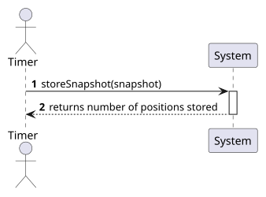
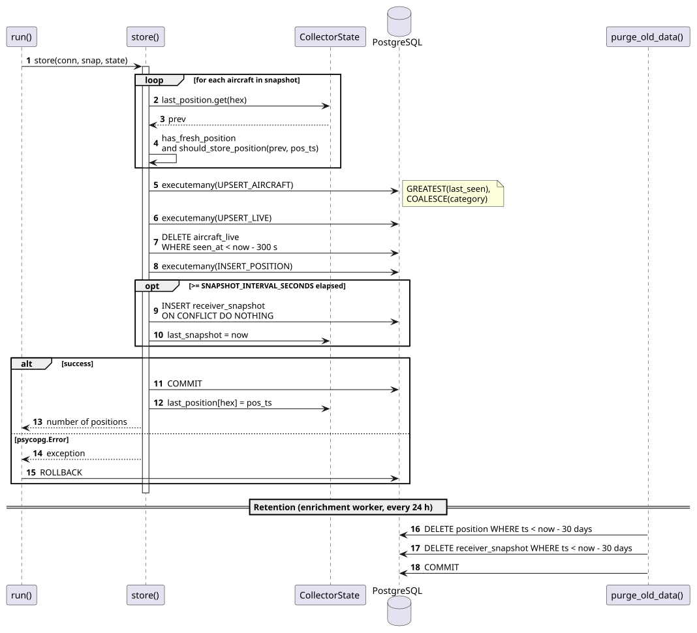

# US02 — Store positions in PostgreSQL

**Epic:** E1 · **Priority:** M · **SP:** 5 · **Status:** ✅ Sprint 1

## User Story

> As the system, I want to store each position in PostgreSQL so that flight history is maintained.

## Acceptance Criteria

- Each seen aircraft is recorded in the `aircraft` table with `first_seen` / `last_seen`.
- The position of each aircraft is stored at most every 15 s.
- Aircraft without a position, or with a position older than 60 s, do not generate rows in `position`.
- The same position is not stored twice.
- The live state of each aircraft is kept in memory, updated on every read; it is removed after 300 s without messages.
- A receiver summary is stored in `receiver_snapshot` every 15 s.
- History is written to Supabase in batches every 15 s; a failed batch is kept and written with the next one.
- Retention: `position` and `receiver_snapshot` are deleted after 7 days.

## Preconditions

- The Supabase migrations have been applied.
- A `Snapshot` produced by US01 is available.

## Postconditions

- The live state reflects the read immediately; `aircraft`, `position` and `receiver_snapshot` reflect it after the next flush (≤ 15 s), written in a single transaction.

## Main Success Scenario

1. The system updates the live state of every aircraft in memory.
2. The system queues the recent positions whose last stored position is ≥ 15 s old.
3. The system removes from the live state aircraft with no messages for more than 300 s.
4. If ≥ 15 s have elapsed since the last summary, it queues a receiver summary.
5. Every 15 s, the system sends the queued aircraft, positions and summaries to Supabase in a single call (`record_batch`), which writes them in one transaction.

## Alternative Flows / Exceptions

| Step | Condition | System response |
|---|---|---|
| 5 | Supabase unavailable or SQL error | The batch is kept in memory (up to 20,000 positions) and sent with the next flush |

## Design Rationale

- The live state stays in memory: it is rewritten on every read and rebuilt from the receiver in seconds, so storing it would only add database writes without benefit.
- Writing in batches (one request every 15 s) keeps the number of requests low; the 15 s resolution keeps the history within the 500 MB of the Supabase free plan for 7 days.
- `GREATEST(last_seen)` and `COALESCE(category)` prevent older or null data from overwriting valid data.
- Purging old data runs in the database itself (daily `pg_cron` job), outside the collection loop.

## Diagrams

- [SSD](puml/ssd_us02.puml) · 
- [SD](puml/sd_us02.puml) · 
