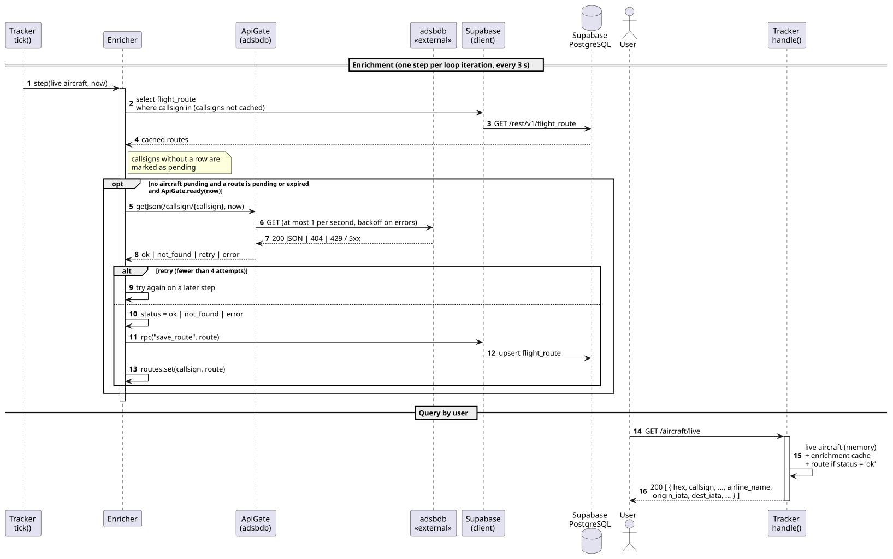

# US03 — View airline and route of a flight

**Epic:** E1 · **Priority:** M · **SP:** 5 · **Status:** ✅ backend in Sprint 1, user interface brought forward to the end of Sprint 1

## User Story

> As a user, I want to view the airline and route (origin → destination) of a flight.

## Acceptance Criteria

- The route (airline, origin → destination) of each seen callsign is fetched from adsbdb and stored in `flight_route`.
- `/aircraft/live`, `/aircraft/{hex}`, and `/ws/live` return the route along with the position.
- Routes with status other than `ok` (not found / error) are not returned.
- The aircraft panel displays the airline and the route as origin and destination codes (IATA, or ICAO when there is no IATA code) with the airport names; without a known route it says so.
- Aircraft seen only by the adsb.fi network (US23) are also enriched, in memory only; nothing about them is stored.

## Preconditions

- The aircraft is in the live state with a known callsign.

## Postconditions

- A row exists in `flight_route` for the callsign, with `status` `ok`, `not_found`, or `error`.

## Main Success Scenario

1. On each loop iteration, the system identifies a live callsign without a route or with an expired route (TTL 7 days; errors after 1 h), looking first in the memory cache and then in `flight_route`.
2. The system queries `GET /v0/callsign/{callsign}` on adsbdb (at most one request per API per iteration).
3. The system stores airline, origin, and destination (ICAO, IATA, name, coordinates) in `flight_route`.
4. The user requests visible aircraft; the system returns them with the associated route.

## Alternative Flows / Exceptions

| Step | Condition | System response |
|---|---|---|
| 2 | adsbdb returns 404 | Stores `status = not_found` (negative cache) |
| 2 | 429, 5xx or network error | Backs off (exponential or `Retry-After`) and retries on a later iteration |
| 2 | Failure after 4 attempts or other 4xx | Stores `status = error`; retries after 1 h |
| 4 | Callsign without `ok` route | Route fields set to `null` |

## Design Rationale

- The route is associated with the **callsign** and not the aircraft: the same aircraft operates multiple flights.
- The API never calls external APIs on user requests; it answers from memory (live state and enrichment cache), ensuring low latency and resilience against external failures.

## Diagrams

- [SSD](puml/ssd_us03.puml) · 
- [SD](puml/sd_us03.puml) · 
