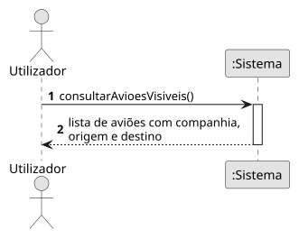
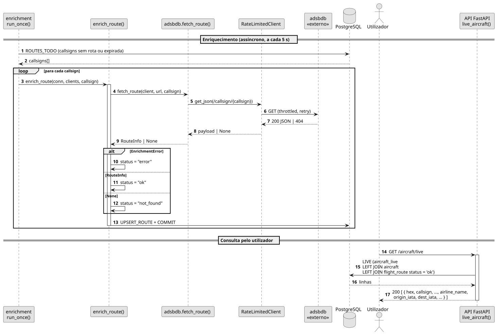

# US03 — Ver a companhia e a rota de um voo

**Épico:** E1 · **Prioridade:** M · **SP:** 5 · **Estado:** 🟡 backend no Sprint 1, UI no Sprint 2

## User Story

> Como utilizador, quero ver a companhia e a rota (origem → destino) de um voo.

## Critérios de Aceitação

- A rota (companhia, origem → destino) de cada callsign visto é obtida no adsbdb e guardada em `flight_route`.
- `/aircraft/live`, `/aircraft/{hex}` e `/ws/live` devolvem a rota junto com a posição.
- Rotas com estado diferente de `ok` (não encontrada / erro) não são devolvidas.
- *(Sprint 2)* O painel da aeronave mostra a companhia e a rota no formato `OPO → LIS`.

## Pré-condições

- A aeronave está em `aircraft_live` com um callsign conhecido.

## Pós-condições

- Existe em `flight_route` uma linha para o callsign, com `status` `ok`, `not_found` ou `error`.

## Cenário Principal

1. O worker identifica os callsigns em `aircraft_live` sem rota ou com rota expirada (TTL 7 dias; erros ao fim de 1 h).
2. Para cada callsign, o sistema consulta `GET /v0/callsign/{callsign}` no adsbdb.
3. O sistema guarda companhia, origem e destino (ICAO, IATA, nome, coordenadas) em `flight_route`.
4. O utilizador pede as aeronaves visíveis; o sistema devolve-as com a rota associada.

## Fluxos Alternativos / Exceções

| Passo | Condição | Resposta do sistema |
|---|---|---|
| 2 | adsbdb devolve 404 | Guarda `status = not_found` (cache negativa) |
| 2 | Falha após todas as tentativas | Guarda `status = error`; repete ao fim de 1 h |
| 4 | Callsign sem rota `ok` | Campos da rota a `null` |

## Justificação do Desenho

- A rota está associada ao **callsign** e não à aeronave: a mesma aeronave opera vários voos.
- A API nunca chama APIs externas no pedido do utilizador; lê sempre da BD, o que garante latência baixa e independência das falhas externas.

## Diagramas

- [SSD](puml/ssd_us03.puml) · 
- [SD](puml/sd_us03.puml) · 
