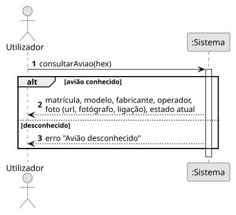
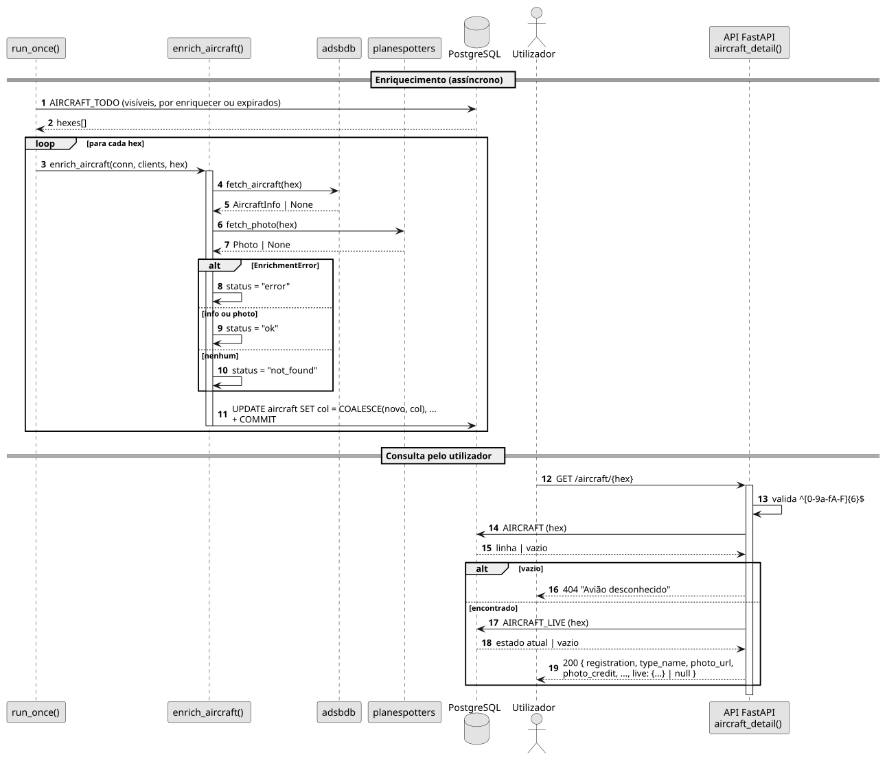

# US04 — Ver a foto, a matrícula e o modelo do avião

**Épico:** E1 · **Prioridade:** S · **SP:** 3 · **Estado:** 🟡 backend no Sprint 1, UI no Sprint 2

## User Story

> Como utilizador, quero ver a foto, a matrícula e o modelo do avião.

## Critérios de Aceitação

- Matrícula, modelo, fabricante, operador e país vêm do adsbdb.
- A foto vem do planespotters.net, com o nome do fotógrafo e a ligação para a página da foto (exigido pelos termos da API).
- `GET /aircraft/{hex}` devolve estes dados e o estado atual (`live`, `null` se não estiver a ser vista); `404` se o hex for desconhecido.
- *(Sprint 2)* O painel mostra a foto com o crédito do fotógrafo.

## Pré-condições

- A aeronave foi vista pelo recetor (existe em `aircraft` e em `aircraft_live`).

## Pós-condições

- A linha da aeronave em `aircraft` tem `enrich_status` (`ok`, `not_found` ou `error`) e `enriched_at`.

## Cenário Principal

1. O worker identifica as aeronaves visíveis por enriquecer ou com dados expirados (TTL 30 dias; erros ao fim de 1 h).
2. Para cada aeronave, o sistema consulta o adsbdb (`/aircraft/{hex}`) e o planespotters (`/hex/{hex}`).
3. O sistema atualiza a linha em `aircraft` sem apagar valores já conhecidos.
4. O utilizador pede o detalhe de uma aeronave; o sistema devolve identificação, fotografia e estado atual.

## Fluxos Alternativos / Exceções

| Passo | Condição | Resposta do sistema |
|---|---|---|
| 2 | Nenhuma das APIs conhece a aeronave | `enrich_status = not_found` |
| 2 | Falha após todas as tentativas | `enrich_status = error`; repete ao fim de 1 h |
| 4 | `hex` com formato inválido | `422` |
| 4 | `hex` desconhecido | `404 "Avião desconhecido"` |

## Justificação do Desenho

- `COALESCE(novo, atual)` no `UPDATE`: uma resposta incompleta não apaga dados obtidos anteriormente.
- Basta uma das fontes responder para o estado ser `ok`.
- O índice `aircraft (enriched_at NULLS FIRST)` dá prioridade às aeronaves nunca enriquecidas.

## Diagramas

- [SSD](puml/ssd_us04.puml) · 
- [SD](puml/sd_us04.puml) · 
