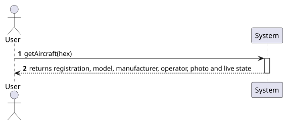
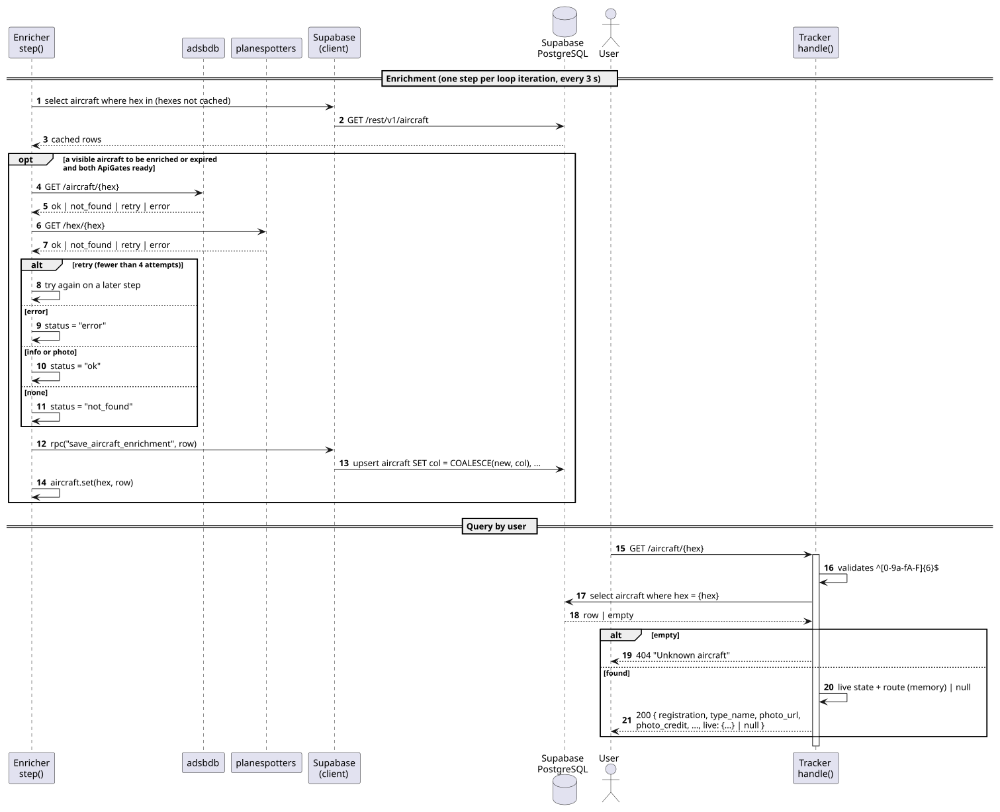

# US04 — View photo, registration, and model of the aircraft

**Epic:** E1 · **Priority:** S · **SP:** 3 · **Status:** 🟡 backend in Sprint 1, UI in Sprint 2

## User Story

> As a user, I want to view the photo, registration, and model of the aircraft.

## Acceptance Criteria

- Registration, model, manufacturer, operator, and country come from adsbdb.
- The photo comes from planespotters.net, with the photographer's name and link to the photo page (required by API terms).
- `GET /aircraft/{hex}` returns these data and the live state (`live`, `null` if not currently seen); `404` if the hex is unknown.
- *(Sprint 2)* The panel displays the photo with photographer credit.

## Preconditions

- The aircraft has been seen by the receiver (exists in `aircraft` and `aircraft_live`).

## Postconditions

- The aircraft row in `aircraft` has `enrich_status` (`ok`, `not_found`, or `error`) and `enriched_at`.

## Main Success Scenario

1. The worker identifies visible aircraft to be enriched or with expired data (TTL 30 days; errors after 1 h).
2. For each aircraft, the system queries adsbdb (`/aircraft/{hex}`) and planespotters (`/hex/{hex}`).
3. The system updates the row in `aircraft` without overwriting already known values.
4. The user requests details for an aircraft; the system returns identification, photograph, and live state.

## Alternative Flows / Exceptions

| Step | Condition | System response |
|---|---|---|
| 2 | Neither API knows the aircraft | `enrich_status = not_found` |
| 2 | Failure after all attempts | `enrich_status = error`; retries after 1 h |
| 4 | `hex` with invalid format | `422` |
| 4 | Unknown `hex` | `404 "Avião desconhecido"` |

## Design Rationale

- `COALESCE(new, current)` in the `UPDATE`: an incomplete response does not overwrite previously obtained data.
- It is sufficient for one of the sources to respond for the status to be `ok`.
- The index `aircraft (enriched_at NULLS FIRST)` gives priority to aircraft never enriched.

## Diagrams

- [SSD](puml/ssd_us04.puml) · 
- [SD](puml/sd_us04.puml) · 
