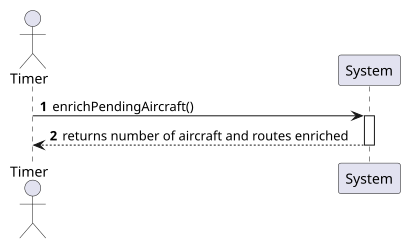
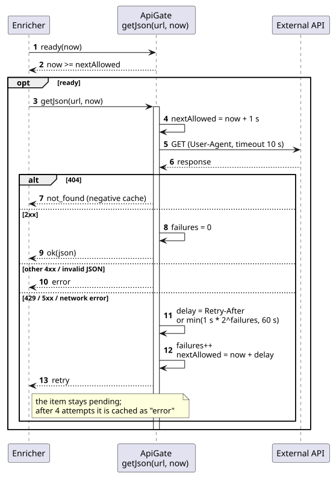

# US05 — Enrichment caching

**Epic:** E1 · **Priority:** S · **SP:** 3 · **Status:** ✅ Sprint 1

## User Story

> As the system, I want to cache enrichment data so that I do not overuse external APIs.

## Acceptance Criteria

- Each hex and each callsign is queried once and cached (aircraft 30 days, route 7 days).
- "Not found" is also cached; errors are retried after 1 h.
- At most 1 request/s per API, with exponential retry and backoff (respects `Retry-After`).
- Only aircraft currently seen by the receiver are enriched.

## Preconditions

- Aircraft exist in the live state.

## Postconditions

- No repeated requests within the TTL; the request rate per API never exceeds the configured rate.

## Main Success Scenario

1. The system looks up the visible aircraft and callsigns not yet in memory in Supabase (one query per table).
2. The system selects one aircraft or callsign without valid cache, if the `ApiGate` of the API allows a new request.
3. The response (or its absence) is stored with status and timestamp in Supabase and in memory.

## Alternative Flows / Exceptions

| Step | Condition | System response |
|---|---|---|
| 2 | HTTP 404 | `not_found` → negative cache |
| 2 | HTTP 429 / 5xx / network error | The API is blocked for `Retry-After` or `base · 2^failures` (max. 60 s); the item is retried on a later iteration, up to 4 attempts |
| 2 | Other 4xx or invalid JSON | `error` immediately |
| 2 | Exhausted attempts | `error`, retried after 1 h |

## Design Rationale

- One `ApiGate` per API, because each API has its own limits.
- `ApiGate` never sleeps: it only says whether a request is allowed at a given instant, so the loop is never kept busy waiting. Time is passed as a parameter, allowing throttle and backoff to be tested without real delays.
- The database is the persistent cache and survives restarts; the memory copy avoids a query per iteration.

## Diagrams

- [SSD](puml/ssd_us05.puml) · 
- [SD](puml/sd_us05.puml) · 
