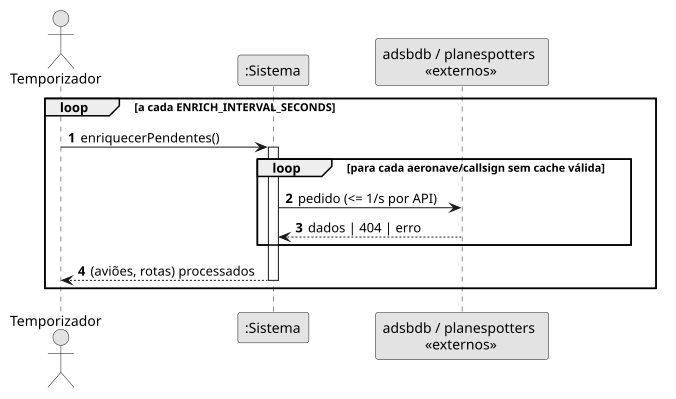
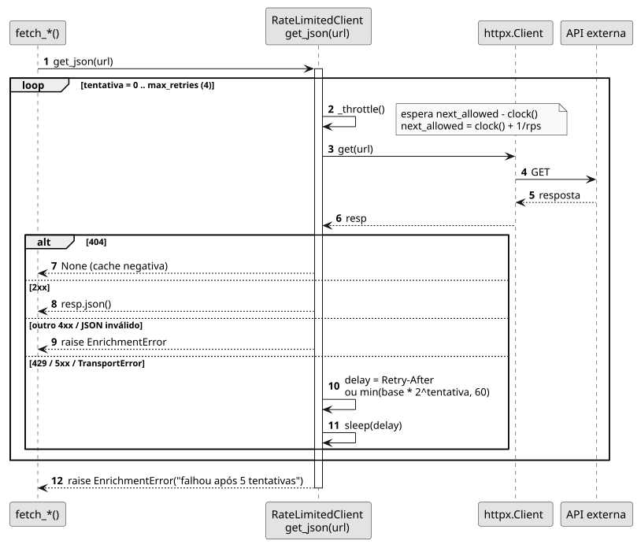

# US05 — Cache do enriquecimento

**Épico:** E1 · **Prioridade:** S · **SP:** 3 · **Estado:** ✅ Sprint 1

## User Story

> Como sistema, quero guardar em cache os dados de enriquecimento para não abusar das APIs externas.

## Critérios de Aceitação

- Cada hex e cada callsign é consultado uma vez e fica em cache (aeronave 30 dias, rota 7 dias).
- "Não encontrado" também fica em cache; os erros são repetidos ao fim de 1 h.
- No máximo 1 pedido/s por API, com *retry* e *backoff* exponencial (respeita `Retry-After`).
- Só são enriquecidas aeronaves que o recetor está a ver.

## Pré-condições

- Existem aeronaves em `aircraft_live`.

## Pós-condições

- Nenhum pedido repetido dentro do TTL; o ritmo de pedidos por API nunca excede o configurado.

## Cenário Principal

1. O worker seleciona apenas aeronaves/callsigns visíveis sem cache válida.
2. Antes de cada pedido, o `RateLimitedClient` espera o necessário para respeitar 1 pedido/s.
3. A resposta (ou a sua ausência) é guardada com estado e instante.

## Fluxos Alternativos / Exceções

| Passo | Condição | Resposta do sistema |
|---|---|---|
| 2 | HTTP 404 | Devolve `None` → cache negativa (`not_found`) |
| 2 | HTTP 429 / 5xx / erro de rede | Espera `Retry-After` ou `base·2^tentativa` (máx. 60 s) e repete até 5 tentativas |
| 2 | Outro 4xx ou JSON inválido | `EnrichmentError` imediato → `error` |
| 2 | Esgotadas as tentativas | `EnrichmentError` → `error`, repetido ao fim de 1 h |

## Justificação do Desenho

- Um `RateLimitedClient` por API, porque cada API tem os seus próprios limites.
- O TTL é aplicado no próprio SQL de seleção (`AIRCRAFT_TODO`, `ROUTES_TODO`), pelo que a "cache" é a BD e sobrevive a reinícios.
- `sleep` e `clock` são injetáveis, o que permite testar o *throttle* e o *backoff* sem esperas reais.

## Diagramas

- [SSD](puml/ssd_us05.puml) · 
- [SD](puml/sd_us05.puml) · 
