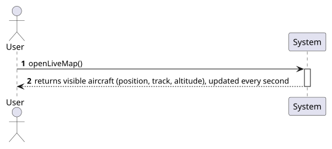
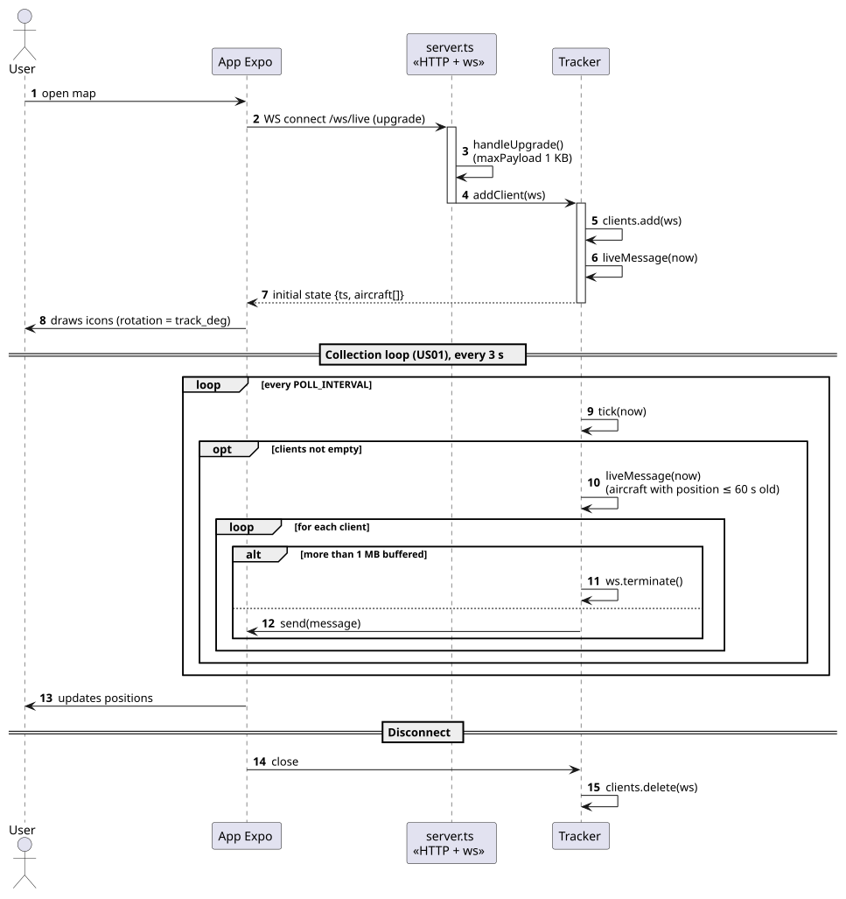

# US06 — View aircraft on a real-time map

**Epic:** E2 · **Priority:** M · **SP:** 5 · **Status:** 🟡 backend (WebSocket) in Sprint 1, app in Sprint 2

## User Story

> As a user, I want to view aircraft on a real-time map, with icons oriented by track.

## Acceptance Criteria

- Upon connecting to `WS /ws/live`, the client immediately receives the live state and thereafter a message every ~1 s (`WS_INTERVAL_SECONDS`).
- Each message has the format `{"ts": ..., "aircraft": [...]}`, identical to `GET /aircraft/live`.
- Only aircraft with a position received ≤ 60 s ago are sent.
- A slow client (send > 2 s) is disconnected without delaying the others.
- *(Sprint 2)* The app draws each aircraft on the MapLibre map with its icon rotated according to `track_deg`.
- *(Sprint 2)* If the connection drops, the app reconnects automatically.

## Preconditions

- The API is active and the collector is populating `aircraft_live`.

## Postconditions

- The map reflects the state of `aircraft_live` with latency ≤ ~2 s.

## Main Success Scenario

1. The user opens the map.
2. The app opens a WebSocket connection to `/ws/live`.
3. The system sends the live state and registers the client with the broadcaster.
4. Every second, the system reads `aircraft_live` **only once** and sends the same message to all clients.
5. The app updates the position and orientation of the icons.

## Alternative Flows / Exceptions

| Step | Condition | System response |
|---|---|---|
| 4 | Client disconnected or send > 2 s | Client removed and connection closed |
| 4 | Database read error | Logs the error; the loop continues in the next second |
| 4 | dump1090 unavailable | Continues sending the last known state until expired |

## Design Rationale

- **Single broadcast** (`LiveBroadcaster`): database load is constant (1 query/s), regardless of the number of clients.
- Without connected clients, the loop does not query the database; therefore, the initial state is sent upon connection.
- `asyncio.wait_for(..., 2 s)` on each send isolates slow clients.

## Diagrams

- [SSD](puml/ssd_us06.puml) · 
- [SD](puml/sd_us06.puml) · 
