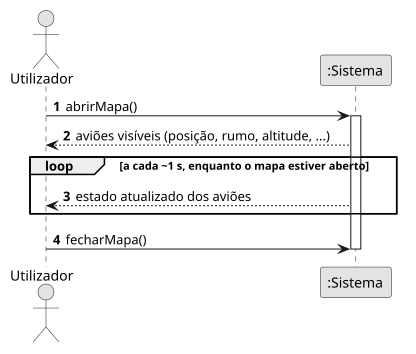
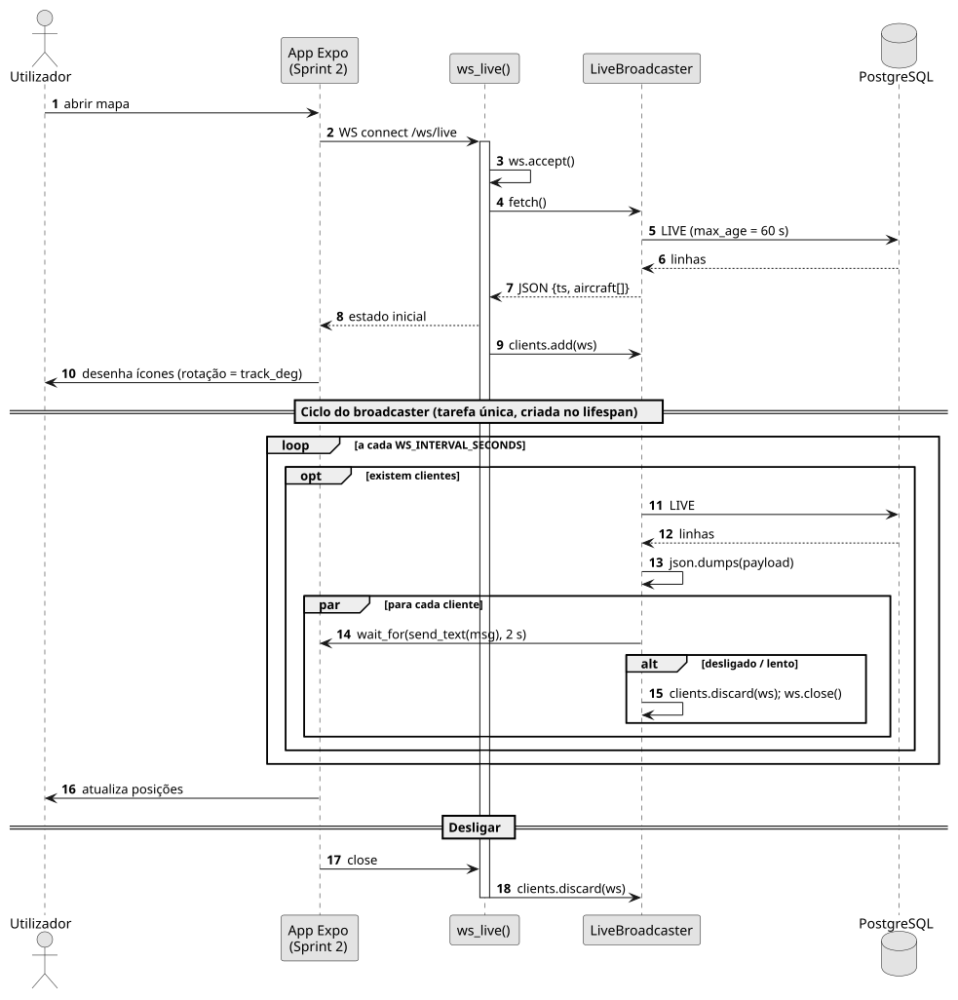

# US06 — Ver os aviões num mapa em tempo real

**Épico:** E2 · **Prioridade:** M · **SP:** 5 · **Estado:** 🟡 backend (WebSocket) no Sprint 1, app no Sprint 2

## User Story

> Como utilizador, quero ver os aviões num mapa em tempo real, com ícone orientado pelo rumo.

## Critérios de Aceitação

- Ao ligar a `WS /ws/live`, o cliente recebe de imediato o estado atual e depois uma mensagem a cada ~1 s (`WS_INTERVAL_SECONDS`).
- Cada mensagem tem o formato `{"ts": ..., "aircraft": [...]}`, igual ao de `GET /aircraft/live`.
- Só são enviados aviões com posição recebida há ≤ 60 s.
- Um cliente lento (envio > 2 s) é desligado sem atrasar os restantes.
- *(Sprint 2)* A app desenha cada avião no mapa MapLibre com o ícone rodado segundo `track_deg`.
- *(Sprint 2)* Se a ligação cair, a app volta a ligar automaticamente.

## Pré-condições

- A API está ativa e o collector está a alimentar `aircraft_live`.

## Pós-condições

- O mapa reflete o estado de `aircraft_live` com atraso ≤ ~2 s.

## Cenário Principal

1. O utilizador abre o mapa.
2. A app abre uma ligação WebSocket a `/ws/live`.
3. O sistema envia o estado atual e regista o cliente no *broadcaster*.
4. A cada segundo, o sistema lê `aircraft_live` **uma única vez** e envia a mesma mensagem a todos os clientes.
5. A app atualiza a posição e a orientação dos ícones.

## Fluxos Alternativos / Exceções

| Passo | Condição | Resposta do sistema |
|---|---|---|
| 4 | Cliente desligado ou envio > 2 s | Cliente removido e ligação fechada |
| 4 | Erro na leitura da BD | Regista o erro; o ciclo continua no segundo seguinte |
| 4 | dump1090 indisponível | Continua a enviar o último estado conhecido até expirar |

## Justificação do Desenho

- **Broadcast único** (`LiveBroadcaster`): o custo na BD é constante (1 consulta/s), independentemente do número de clientes.
- Sem clientes ligados o ciclo não consulta a BD; por isso o estado inicial é enviado no momento da ligação.
- `asyncio.wait_for(..., 2 s)` em cada envio isola os clientes lentos.

## Diagramas

- [SSD](puml/ssd_us06.puml) · 
- [SD](puml/sd_us06.puml) · 
