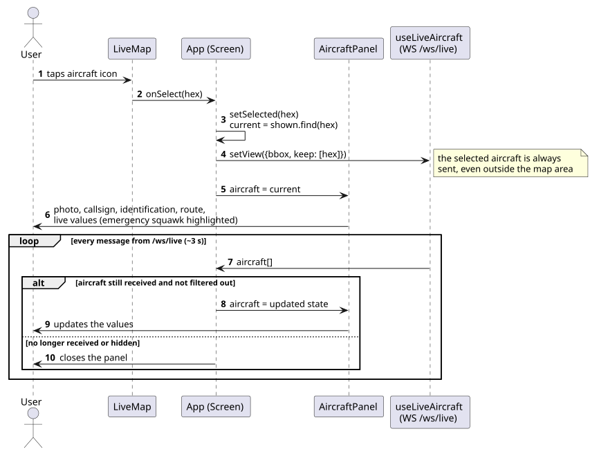

# US07 — View aircraft detail panel

**Epic:** E2 · **Priority:** M · **SP:** 3 · **Status:** 🟡 backend in Sprint 1, app in Sprint 2

## User Story

> As a user, I want to click on an aircraft and view a panel with altitude, speed, squawk, route, and photo.

## Acceptance Criteria

- When selecting an aircraft on the map, the app requests `GET /aircraft/{hex}`.
- The panel displays: callsign, registration, model, operator, altitude (ft), speed (kt), vertical rate, squawk, track, route (origin → destination), and photo with credit.
- If the aircraft is no longer seen, the panel indicates that the state is not current (`live = null`).
- Emergency squawks (`7500`, `7600`, `7700`) are highlighted.
- Panel data track updates from `/ws/live`.

## Preconditions

- The map is open (US06) and the aircraft is visible.

## Postconditions

- The panel presents the data of the selected aircraft.

## Main Success Scenario

1. The user selects an aircraft on the map.
2. The app requests details from the system.
3. The system returns identification, photograph, route, and live state.
4. The app displays the panel and updates it with subsequent WebSocket messages.

## Alternative Flows / Exceptions

| Step | Condition | System response |
|---|---|---|
| 3 | Unknown hex | `404`; the app displays only WebSocket data |
| 3 | Enrichment still pending | Identification/photo fields set to `null`; the app displays "fetching data" |

## Design Rationale

- Detail reuses the endpoint from US04; dynamic state comes from the already open WebSocket, avoiding polling.

## Diagrams

- [SSD](puml/ssd_us07.puml) · 
- [SD](puml/sd_us07.puml) · 
