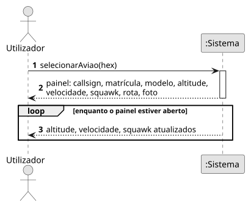
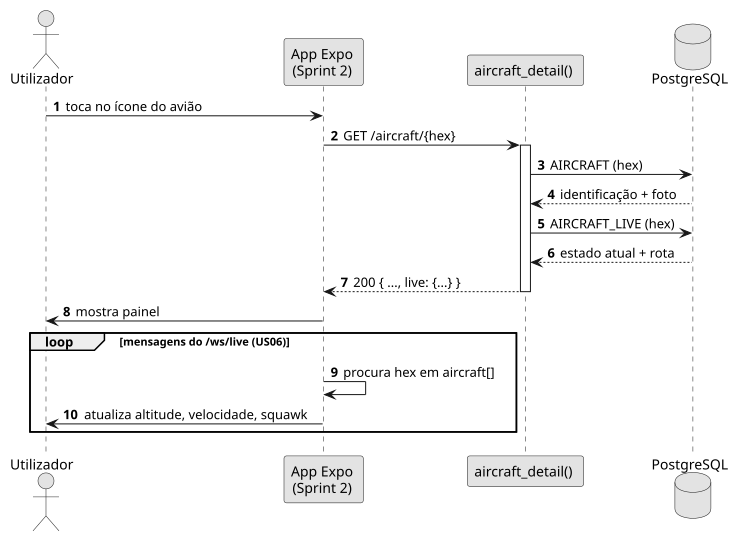

# US07 — Ver o painel de detalhe de um avião

**Épico:** E2 · **Prioridade:** M · **SP:** 3 · **Estado:** 🟡 backend no Sprint 1, app no Sprint 2

## User Story

> Como utilizador, quero clicar num avião e ver um painel com altitude, velocidade, squawk, rota e foto.

## Critérios de Aceitação

- Ao selecionar um avião no mapa, a app pede `GET /aircraft/{hex}`.
- O painel mostra: callsign, matrícula, modelo, operador, altitude (ft), velocidade (kt), razão vertical, squawk, rumo, rota (origem → destino) e foto com crédito.
- Se o avião deixar de ser visto, o painel indica que o estado não é atual (`live = null`).
- Squawks de emergência (`7500`, `7600`, `7700`) são destacados.
- Os dados do painel acompanham as atualizações do `/ws/live`.

## Pré-condições

- O mapa está aberto (US06) e o avião está visível.

## Pós-condições

- O painel apresenta os dados da aeronave selecionada.

## Cenário Principal

1. O utilizador seleciona um avião no mapa.
2. A app pede o detalhe ao sistema.
3. O sistema devolve identificação, fotografia, rota e estado atual.
4. A app mostra o painel e atualiza-o com as mensagens seguintes do WebSocket.

## Fluxos Alternativos / Exceções

| Passo | Condição | Resposta do sistema |
|---|---|---|
| 3 | Hex desconhecido | `404`; a app mostra só os dados do WebSocket |
| 3 | Enriquecimento ainda por fazer | Campos de identificação/foto a `null`; a app mostra "a obter dados" |

## Justificação do Desenho

- O detalhe reutiliza o endpoint da US04; o estado dinâmico vem do WebSocket já aberto, evitando *polling*.

## Diagramas

- [SSD](puml/ssd_us07.puml) · 
- [SD](puml/sd_us07.puml) · 
