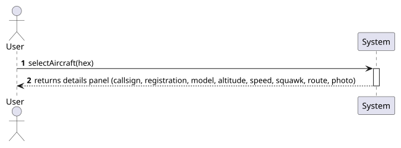

# US07 — View aircraft detail panel

**Epic:** E2 · **Priority:** M · **SP:** 3 · **Status:** ✅ backend in Sprint 1, app brought forward to the end of Sprint 1

## User Story

> As a user, I want to click on an aircraft and view a panel with altitude, speed, squawk, route, and photo.

## Acceptance Criteria

- Selecting an aircraft on the map (or a search result, US09) opens the panel with the data already received over `/ws/live`, which includes the enrichment and the route, so no extra request is needed.
- The panel displays: photo with credit, callsign, registration, model, operator, route (origin → destination), altitude (ft), ground speed (kt), track, vertical rate (climbing / descending), squawk, ICAO address, signal (dBFS) and position source (ADS-B or MLAT).
- The panel states the source of the aircraft (Porto receiver or adsb.fi) and, for adsb.fi, shows the extra parameters it provides (US23).
- Emergency squawks (`7500`, `7600`, `7700`) are highlighted with their meaning.
- The panel updates with every message from `/ws/live`; when the aircraft is no longer received (or is hidden by the filters), the panel closes.

## Preconditions

- The map is open (US06) and the aircraft is visible.

## Postconditions

- The panel presents the data of the selected aircraft.

## Main Success Scenario

1. The user selects an aircraft on the map.
2. The app requests details from the system.
3. The system returns identification, photograph, route, and live state.
4. The app displays the panel and updates it with subsequent WebSocket messages.

## Alternative Flows / Exceptions

| Step | Condition | System response |
|---|---|---|
| 3 | Enrichment still pending | Identification and photo are `null`; the panel shows "Not yet identified" and fills in when enrichment arrives |
| 3 | Route unknown | The panel says the route is not known for this callsign |

## Design Rationale

- The live message already carries identification, photo and route, so the panel needs no request of its own and never polls; `GET /aircraft/{hex}` (US04) remains for aircraft that are not on the map (US09).
- The layout follows an ATC flight progress strip: ruled boxes, the altitude colour as the strip edge, and codes in a monospaced face.

## Diagrams

- [SSD](puml/ssd_us07.puml) · 
- [SD](puml/sd_us07.puml) · 
