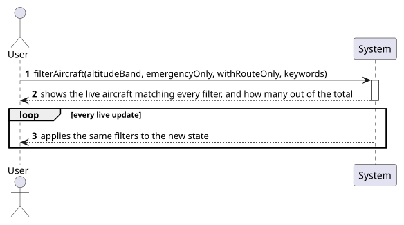

# US08 — Filter aircraft

**Epic:** E2 · **Priority:** M · **SP:** 5 · **Status:** ⏳ planned for Sprint 2

## User Story

> As a user, I want to filter by origin/destination airport, altitude, airline, and aircraft type.

## Acceptance Criteria (proposed)

- It is possible to filter by origin and/or destination airport (ICAO or IATA code).
- It is possible to filter by altitude range (ft), including aircraft on the ground only.
- It is possible to filter by airline (ICAO/IATA) and aircraft type (`icao_type`).
- Filters combine (logical AND) and also apply to real-time updates.
- Aircraft lacking the filtered data (e.g. unknown route) are excluded when that filter is active.

> Criteria to be validated during Sprint 2 planning; the design (SD) will be produced at that stage.

## Diagrams

- [SSD](puml/ssd_us08.puml) · 
- SD: to be produced during Sprint 2 planning.
