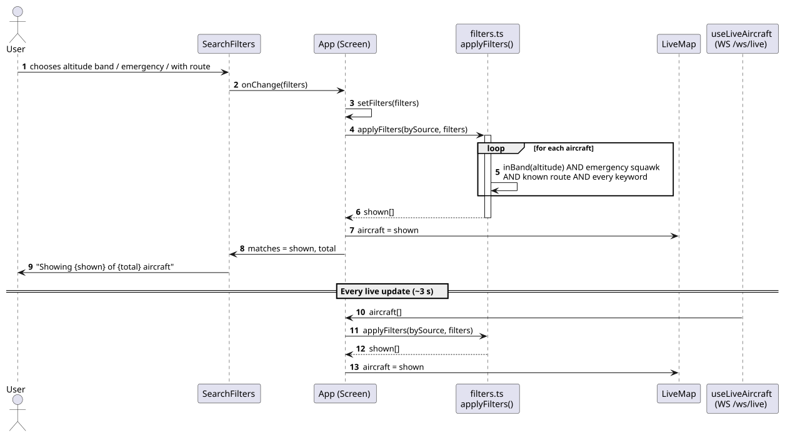

# US08 — Filter aircraft

**Epic:** E2 · **Priority:** M · **SP:** 5 · **Status:** ✅ implemented in Sprint 1 (brought forward)

## User Story

> As a user, I want to filter by origin/destination airport, altitude, airline, and aircraft type.

## Acceptance Criteria

- Quick filters: altitude band (all, on the ground, below 10,000 ft, 10,000 to 30,000 ft, above 30,000 ft), emergency squawks only (`7500`, `7600`, `7700`) and aircraft with a known route only.
- Airport (ICAO or IATA, origin or destination), airline (ICAO, IATA or name) and aircraft type (`icao_type` or model) are filtered with search keywords (US09), for example `LPPR A320`.
- Filters combine (logical AND), together with the source filter (US23), and apply to every real-time update.
- Aircraft lacking the filtered data (unknown altitude or route) are excluded when that filter is active.
- While filtering, the app shows how many aircraft are displayed out of the total, and a single action clears every filter.

## Preconditions

- The map is open (US06).

## Postconditions

- The map shows only the aircraft that match every active filter.

## Main Success Scenario

1. The user chooses an altitude band and/or the emergency or route filter.
2. The app applies the filters to the live state and redraws the map.
3. The app shows how many aircraft are displayed out of the total.
4. With each WebSocket message, the app applies the same filters to the new state.

## Alternative Flows / Exceptions

| Step | Condition | System response |
|---|---|---|
| 2 | No aircraft match | The map is empty and the count shows 0 |
| 2 | The selected aircraft no longer matches | Its panel closes; it reopens if the filters are cleared while it is still selected |

## Design Rationale

- Filtering runs in the app over the live state it already receives, so it needs no new endpoint, follows every update at no cost, and works identically for both sources.
- A free-text keyword covers airports, airlines and types with one control instead of three lists, and matches both codes and names.
- The filter logic is a pure function (`applyFilters`), separate from the interface.

## Diagrams

- [SSD](puml/ssd_us08.puml) · 
- [SD](puml/sd_us08.puml) · 
