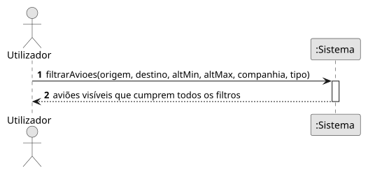

# US08 — Filtrar aviões

**Épico:** E2 · **Prioridade:** M · **SP:** 5 · **Estado:** ⏳ planeado para o Sprint 2

## User Story

> Como utilizador, quero filtrar por aeroporto de origem/destino, altitude, companhia e tipo de avião.

## Critérios de Aceitação (proposta)

- É possível filtrar por aeroporto de origem e/ou destino (código ICAO ou IATA).
- É possível filtrar por intervalo de altitude (ft), incluindo apenas aviões no solo.
- É possível filtrar por companhia (ICAO/IATA) e por tipo de aeronave (`icao_type`).
- Os filtros combinam-se (E lógico) e aplicam-se também às atualizações em tempo real.
- Os aviões sem o dado filtrado (p. ex. rota desconhecida) ficam excluídos quando esse filtro está ativo.

> Critérios a validar no planeamento do Sprint 2; o desenho (SD) é feito nessa altura.

## Diagramas

- [SSD](puml/ssd_us08.puml) · 
- SD: a elaborar no planeamento do Sprint 2.
