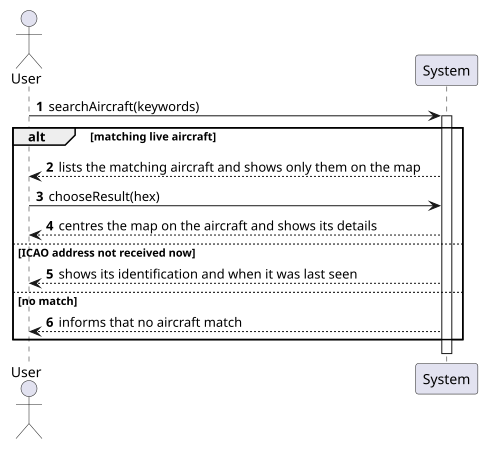

# US09 — Search aircraft

**Epic:** E2 · **Priority:** S · **SP:** 2 · **Status:** ⏳ planned for Sprint 2

## User Story

> As a user, I want to search by callsign, registration, or hex.

## Acceptance Criteria (proposed)

- Search accepts callsign, registration, or hex, case-insensitively.
- If the aircraft is visible, the map centres on it and opens the panel (US07).
- If it is not visible but known, it displays its data and the last time it was seen.
- With no results, an informative message is displayed.

> Criteria to be validated during Sprint 2 planning; the design (SD) will be produced at that stage.

## Diagrams

- [SSD](puml/ssd_us09.puml) · 
- SD: to be produced during Sprint 2 planning.
