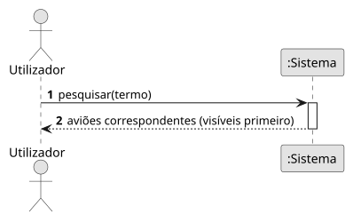

# US09 — Pesquisar avião

**Épico:** E2 · **Prioridade:** S · **SP:** 2 · **Estado:** ⏳ planeado para o Sprint 2

## User Story

> Como utilizador, quero pesquisar por callsign, matrícula ou hex.

## Critérios de Aceitação (proposta)

- A pesquisa aceita callsign, matrícula ou hex, sem distinguir maiúsculas/minúsculas.
- Se o avião estiver visível, o mapa centra-se nele e abre o painel (US07).
- Se não estiver visível mas for conhecido, mostra os dados e a última vez que foi visto.
- Sem resultados, é apresentada uma mensagem informativa.

> Critérios a validar no planeamento do Sprint 2; o desenho (SD) é feito nessa altura.

## Diagramas

- [SSD](puml/ssd_us09.puml) · 
- SD: a elaborar no planeamento do Sprint 2.
