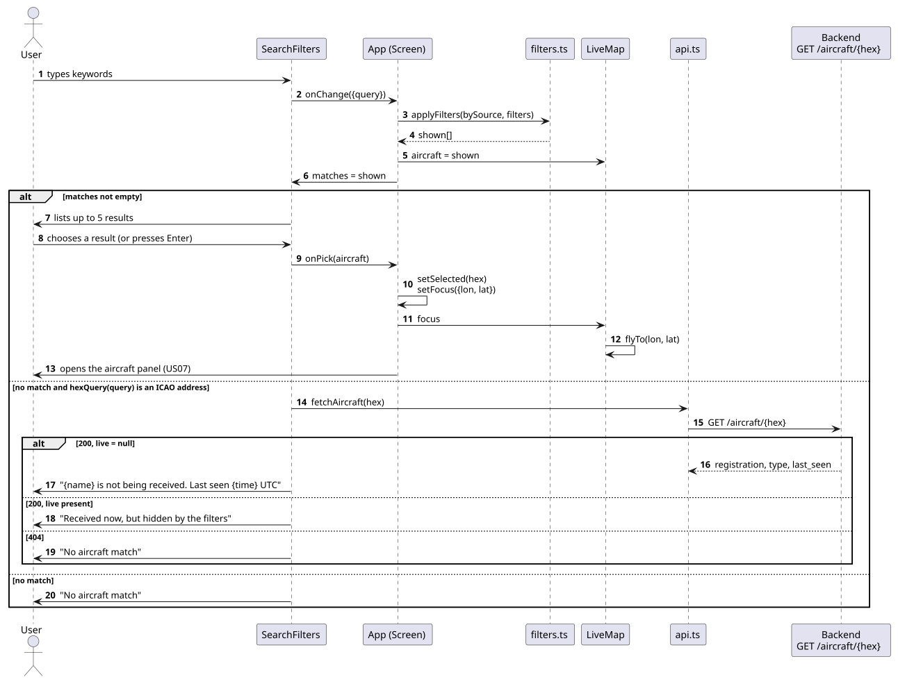

# US09 — Search aircraft

**Epic:** E2 · **Priority:** S · **SP:** 2 · **Status:** ✅ implemented in Sprint 1 (brought forward)

## User Story

> As a user, I want to search by callsign, registration, or hex.

## Acceptance Criteria

- The search accepts one or more keywords, case-insensitively; an aircraft matches when every keyword appears in its callsign, registration, ICAO address (hex), airline, type, operator, origin or destination airport, or squawk.
- The map shows only the matching aircraft, and up to five results are listed with callsign, type and route.
- Choosing a result (or pressing Enter for the first one) centres the map on the aircraft and opens its panel (US07).
- If an ICAO address is not on the map but is known, the app shows its registration and type and when it was last seen.
- With no results, an informative message is displayed.

## Preconditions

- The map is open (US06).

## Postconditions

- The chosen aircraft is centred and selected, or the user is told why it is not shown.

## Main Success Scenario

1. The user types keywords in the search field.
2. The app filters the live state and lists the matching aircraft.
3. The user chooses a result.
4. The app centres the map on the aircraft and opens its panel.

## Alternative Flows / Exceptions

| Step | Condition | System response |
|---|---|---|
| 2 | No match, and the query is an ICAO address | The app requests `GET /aircraft/{hex}`: if known, it shows its identification and last time seen; if it is being received but hidden by other filters, it says so; if unknown (`404`), it shows the no-results message |
| 2 | No match | "No aircraft match" |

## Design Rationale

- The search reuses the filter logic of US08: the keywords are one more filter over the live state.
- Only an ICAO address is looked up in the stored history, because it is the key of the stored aircraft; registrations and callsigns change meaning over time.

## Diagrams

- [SSD](puml/ssd_us09.puml) · 
- [SD](puml/sd_us09.puml) · 
