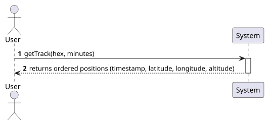

# US10 — View aircraft track

**Epic:** E2 · **Priority:** S · **SP:** 3 · **Status:** 🟡 backend in Sprint 1, app in Sprint 2

## User Story

> As a user, I want to view the track that the aircraft has already flown.

## Acceptance Criteria

- `GET /aircraft/{hex}/track?minutes=N` returns stored positions for the last N minutes (1–1440, default 60), in chronological order.
- Each point has `ts`, `lat`, `lon`, `altitude_ft`, `speed_kt`, `track_deg`, `on_ground`.
- *(Sprint 2)* Upon selecting an aircraft, the app draws the track as a line, coloured by altitude.
- *(Sprint 2)* The track is extended with positions received via WebSocket.

## Preconditions

- Stored positions exist for the aircraft (US02).

## Postconditions

- The map displays the aircraft's path over the requested interval.

## Main Success Scenario

1. The user selects an aircraft.
2. The app requests the track from the system.
3. The system returns positions for the interval.
4. The app draws the line and appends new points as they arrive.

## Alternative Flows / Exceptions

| Step | Condition | System response |
|---|---|---|
| 2 | `minutes` outside 1–1440 or invalid hex | `422` |
| 3 | No positions in the interval | `200 []`; no track is drawn |

## Design Rationale

- The index `position (hex, ts)` makes the query proportional to the number of points for the aircraft, rather than table size.
- Track resolution is 1 point / 15 s (US02 threshold), sufficient for a smooth line.

## Diagrams

- [SSD](puml/ssd_us10.puml) · 
- [SD](puml/sd_us10.puml) · 
