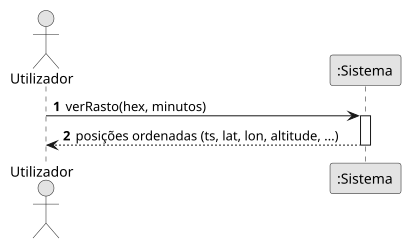
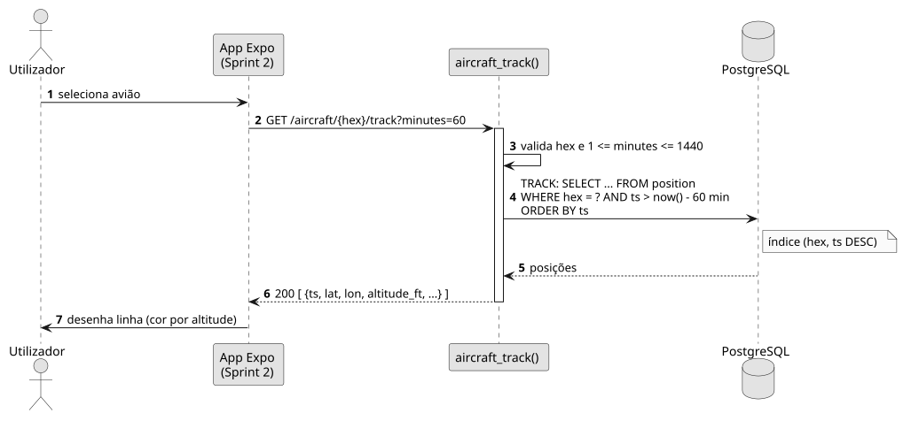

# US10 — Ver o rasto de um avião

**Épico:** E2 · **Prioridade:** S · **SP:** 3 · **Estado:** 🟡 backend no Sprint 1, app no Sprint 2

## User Story

> Como utilizador, quero ver o rasto que o avião já percorreu.

## Critérios de Aceitação

- `GET /aircraft/{hex}/track?minutes=N` devolve as posições guardadas nos últimos N minutos (1–1440, por omissão 60), por ordem cronológica.
- Cada ponto tem `ts`, `lat`, `lon`, `altitude_ft`, `speed_kt`, `track_deg`, `on_ground`.
- *(Sprint 2)* Ao selecionar um avião, a app desenha o rasto como linha, colorida por altitude.
- *(Sprint 2)* O rasto é prolongado com as posições recebidas pelo WebSocket.

## Pré-condições

- Existem posições guardadas para o avião (US02).

## Pós-condições

- O mapa apresenta o percurso do avião no intervalo pedido.

## Cenário Principal

1. O utilizador seleciona um avião.
2. A app pede o rasto ao sistema.
3. O sistema devolve as posições do intervalo.
4. A app desenha a linha e vai acrescentando os pontos novos.

## Fluxos Alternativos / Exceções

| Passo | Condição | Resposta do sistema |
|---|---|---|
| 2 | `minutes` fora de 1–1440 ou hex inválido | `422` |
| 3 | Sem posições no intervalo | `200 []`; não é desenhado rasto |

## Justificação do Desenho

- O índice `position (hex, ts DESC)` torna a consulta proporcional ao número de pontos do avião, e não ao tamanho da tabela.
- A resolução do rasto é de 1 ponto / 5 s (limite da US02), suficiente para uma linha suave.

## Diagramas

- [SSD](puml/ssd_us10.puml) · 
- [SD](puml/sd_us10.puml) · 
