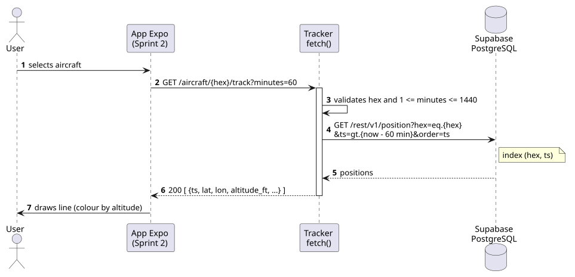

# US10 — View aircraft track

**Epic:** E2 · **Priority:** S · **SP:** 3 · **Status:** ✅ backend in Sprint 1, app brought forward to the end of Sprint 1

## User Story

> As a user, I want to view the track that the aircraft has already flown.

## Acceptance Criteria

- `GET /aircraft/{hex}/track?minutes=N` returns stored positions for the last N minutes (1–1440, default 60), in chronological order.
- Each point has `ts`, `lat`, `lon`, `altitude_ft`, `speed_kt`, `track_deg`, `on_ground`.
- Upon selecting a receiver aircraft, the app draws its track of the last 60 minutes as a line, each segment coloured by altitude.
- The track ends at the current position from the WebSocket and is refreshed every 15 s while the aircraft stays selected.
- Aircraft seen only by adsb.fi have no track (their positions are not stored), and the panel says so.

## Preconditions

- Stored positions exist for the aircraft (US02).

## Postconditions

- The map displays the aircraft's path over the requested interval.

## Main Success Scenario

1. The user selects an aircraft.
2. The app requests the track from the system.
3. The system returns positions for the interval.
4. The app draws the line up to the current position and refreshes it every 15 s.

## Alternative Flows / Exceptions

| Step | Condition | System response |
|---|---|---|
| 2 | `minutes` outside 1–1440 or invalid hex | `422` |
| 3 | No positions in the interval | `200 []`; no track is drawn |

## Design Rationale

- The index `position (hex, ts)` makes the query proportional to the number of points for the aircraft, rather than table size.
- Track resolution is 1 point / 15 s (US02 threshold), sufficient for a smooth line.

## Diagrams

- [SSD](puml/ssd_us10.puml) · 
- [SD](puml/sd_us10.puml) · 
