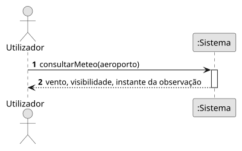

# US11 — Ver informação meteorológica (METAR)

**Épico:** E2 · **Prioridade:** C · **SP:** 2 · **Estado:** ⏳ planeado para o Sprint 4

## User Story

> Como utilizador, quero ver informação meteorológica discreta (METAR: vento, visibilidade) no painel do aeroporto e um indicador no mapa.

## Critérios de Aceitação (proposta)

- O METAR dos aeroportos relevantes (pelo menos LPPR) é obtido de uma fonte pública e guardado em cache.
- O painel do aeroporto mostra vento (direção/intensidade), visibilidade e hora da observação.
- O mapa mostra um indicador discreto junto ao aeroporto.
- Se o METAR tiver mais de 2 h, é marcado como desatualizado.

> Critérios a validar no planeamento do Sprint 4; o desenho (SD) é feito nessa altura.

## Diagramas

- [SSD](puml/ssd_us11.puml) · 
- SD: a elaborar no planeamento do Sprint 4.
