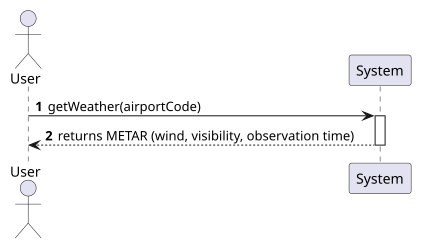

# US11 — View meteorological information (METAR)

**Epic:** E2 · **Priority:** C · **SP:** 2 · **Status:** ⏳ planned for Sprint 4

## User Story

> As a user, I want to view subtle weather information (METAR: wind, visibility) in the airport panel and an indicator on the map.

## Acceptance Criteria (proposed)

- METAR for relevant airports (at least LPPR) is fetched from a public source and cached.
- The airport panel displays wind (direction/speed), visibility, and observation time.
- The map displays an unobtrusive indicator next to the airport.
- If the METAR is older than 2 h, it is marked as outdated.

> Criteria to be validated during Sprint 4 planning; the design (SD) will be produced at that stage.

## Diagrams

- [SSD](puml/ssd_us11.puml) · 
- SD: to be produced during Sprint 4 planning.
