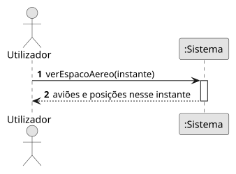

# US12 — Replay do espaço aéreo

**Épico:** E3 · **Prioridade:** S · **SP:** 8 · **Estado:** ⏳ planeado para o Sprint 3

## User Story

> Como utilizador, quero escolher um momento passado numa barra de tempo e ver o espaço aéreo como estava (replay).

## Critérios de Aceitação (proposta)

- A barra de tempo cobre o período de retenção (30 dias).
- Para o instante escolhido, o mapa mostra a última posição de cada avião nos 60 s anteriores.
- É possível reproduzir a partir desse instante a velocidades 1×, 10× e 60×.
- Durante o replay é claro que não se trata de tempo real; é possível voltar ao modo live.

> Critérios a validar no planeamento do Sprint 3; o desenho (SD) é feito nessa altura.

## Diagramas

- [SSD](puml/ssd_us12.puml) · 
- SD: a elaborar no planeamento do Sprint 3.
