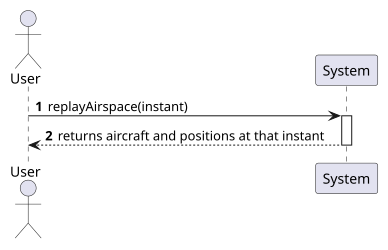
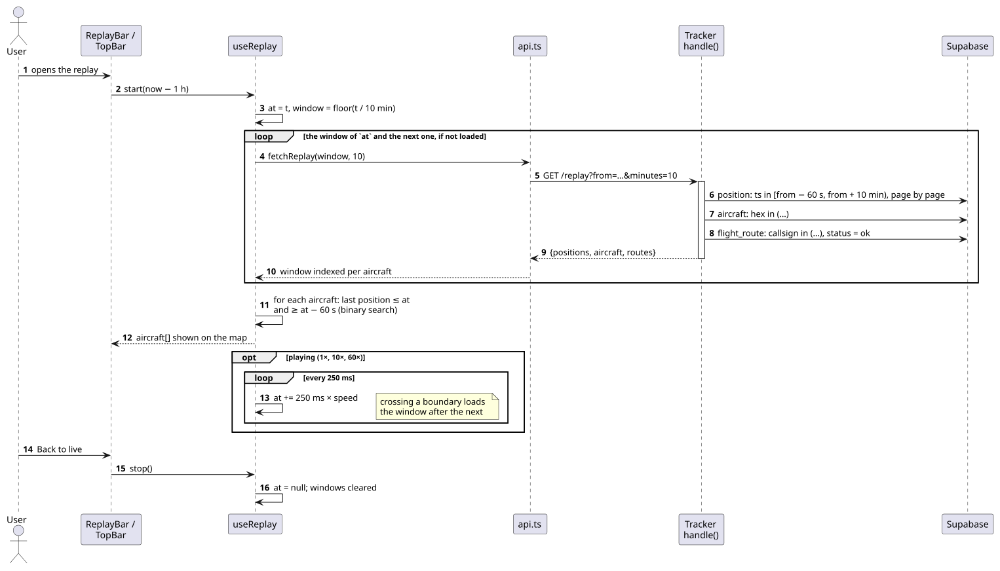

# US12 — Airspace replay

**Epic:** E3 · **Priority:** S · **SP:** 8 · **Status:** ✅ implemented in Sprint 1 (brought forward)

## User Story

> As a user, I want to choose a past moment on a timeline and view the airspace as it was (replay).

## Acceptance Criteria

- A replay can start at any moment of the retention period (7 days), chosen with a date and time field (UTC) or with jumps of ±10 min and ±1 h; it opens one hour in the past.
- For the replay time, the map shows the last stored position of each aircraft in the preceding 60 s, as the live map does, with its identification and route.
- The replay can play from that moment at 1×, 10× and 60×, and pause; playback stops when it reaches the present.
- During a replay the title block and a bar at the bottom of the map show "Replay" and the replay time in the warning colour; "Back to live" returns to the live map.
- Search, filters and the aircraft panel work on the replayed airspace; the selected aircraft shows its track up to the replay time.
- Only the course receiver is replayed, since adsb.fi aircraft are never stored.

## Preconditions

- Positions are stored (US02) and within the retention period.

## Postconditions

- The map shows the airspace at the chosen moment, until the user returns to live.

## Main Success Scenario

1. The user opens the replay.
2. The app requests from the system the stored positions of the 10-minute window containing the replay time, and the next one.
3. The system returns the positions (from 60 s before the window), with the identification of the aircraft and the routes of their callsigns.
4. The app shows, for the replay time, the last position of each aircraft in the preceding 60 s.
5. The user plays the replay; the app advances the time and requests each next window in advance.
6. The user returns to live.

## Alternative Flows / Exceptions

| Step | Condition | System response |
|---|---|---|
| 2 | `from` is not a timestamp, or `minutes` outside 1–15 | `422` |
| 3 | No positions in the window | The app says that no aircraft are stored at that moment |
| 3 | Request fails | The app says the history could not be loaded and retries when the time changes |

## Design Rationale

- The history is loaded in 10-minute windows, about 100 KB each, rather than as one large request or one request per frame; the next window is requested in advance, so playback at 60× (10 minutes every 10 s) does not stop at the boundaries.
- Each window starts 60 s before its start time, so a single window answers every instant inside it.
- The airspace at an instant is computed in the app (the last position at or before it, found by binary search per aircraft), so changing the time or the speed needs no request.
- The Data API returns at most 1000 rows per request, so the backend reads the window page by page, with an upper bound.

## Diagrams

- [SSD](puml/ssd_us12.puml) · 
- [SD](puml/sd_us12.puml) · 
