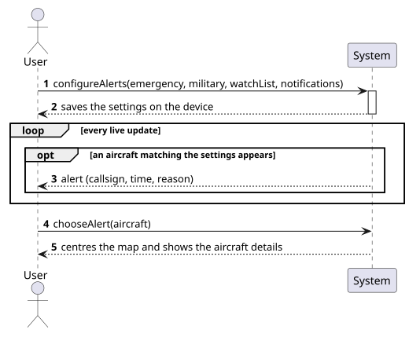
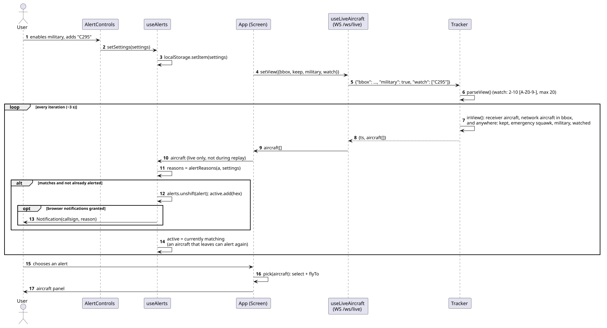

# US13 — Configure alerts

**Epic:** E3 · **Priority:** S · **SP:** 5 · **Status:** ✅ implemented in Sprint 1 (brought forward)

## User Story

> As a user, I want to enable/disable and configure alerts (emergency 7500/7600/7700, specific aircraft or model, military).

## Acceptance Criteria

- Emergency alerts (squawk 7500, 7600, 7700) can be enabled or disabled; they are enabled by default.
- Aircraft can be watched by ICAO address, registration, aircraft type or callsign (up to 20 entries, case-insensitive).
- Alerts for military aircraft can be enabled; an aircraft is military when the adsb.fi database flags it, so a receiver aircraft is only recognised as military while the network also sees it.
- An alert fires once when a matching aircraft appears and does not repeat while it remains received; it fires again if the aircraft disappears and comes back.
- Alerts cover the whole area of the adsb.fi network, not only the visible map: the server also sends the aircraft the alerts need.
- Each alert shows the callsign, the time and the reason; choosing it centres the map on the aircraft and opens its panel; it can be dismissed. At most four are shown.
- Optionally, alerts are also shown as browser notifications, after the browser grants permission.
- The settings persist on the device. Alerts follow the live airspace only, not the replay (US12).

## Preconditions

- The map is open and receiving the live state (US06).

## Postconditions

- The user is told when an aircraft matching the settings appears.

## Main Success Scenario

1. The user enables the military alert and adds an aircraft type to the watch list.
2. The app saves the settings on the device and sends them to the system with the visible map area.
3. The system sends, with every live update, the aircraft in the visible area plus emergencies, military aircraft and watched aircraft anywhere.
4. A matching aircraft appears; the app shows an alert (and a browser notification, if enabled).
5. The user chooses the alert; the app centres the map on the aircraft and opens its panel.

## Alternative Flows / Exceptions

| Step | Condition | System response |
|---|---|---|
| 2 | Invalid watch entry (not 2–10 letters, digits or hyphens) | Ignored by the system |
| 4 | The aircraft was already alerted and is still received | No new alert |
| 4 | Browser notifications denied | Alerts are shown in the app only |

## Design Rationale

- Matching runs in the app, over the live state it already receives, so settings stay on the device and need no account (US20).
- Because the server only sends the adsb.fi aircraft in the visible area (US23), it also receives the alert settings and sends the few aircraft they need anywhere; without this, an alert could fire for an aircraft that the next update no longer contains.
- Military status comes from the adsb.fi database flag, the only free source available; other heuristics (callsign prefixes, address ranges) were not used because they produce false positives.

## Diagrams

- [SSD](puml/ssd_us13.puml) · 
- [SD](puml/sd_us13.puml) · 
