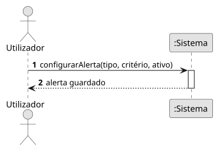

# US13 — Configurar alertas

**Épico:** E3 · **Prioridade:** S · **SP:** 5 · **Estado:** ⏳ planeado para o Sprint 3

## User Story

> Como utilizador, quero ativar/desativar e configurar alertas (emergência 7500/7600/7700, avião ou modelo específico, militares).

## Critérios de Aceitação (proposta)

- Os alertas de emergência (squawk 7500, 7600, 7700) podem ser ativados/desativados.
- É possível criar alertas para um hex, matrícula ou tipo de aeronave específicos.
- É possível ativar um alerta para aeronaves militares.
- Um alerta dispara uma vez por aparecimento do avião e não se repete enquanto continuar visível.
- A configuração persiste entre sessões no mesmo dispositivo.

> Critérios a validar no planeamento do Sprint 3; o desenho (SD) é feito nessa altura.

## Diagramas

- [SSD](puml/ssd_us13.puml) · 
- SD: a elaborar no planeamento do Sprint 3.
