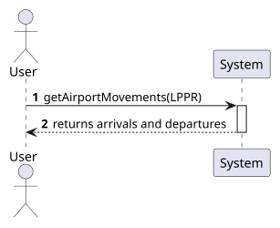

# US14 — LPPR arrivals and departures

**Epic:** E3 · **Priority:** C · **SP:** 5 · **Status:** ⏳ planned for Sprint 4

## User Story

> As a user, I want to view arrivals and departures for Porto airport (LPPR).

## Acceptance Criteria (proposed)

- The arrivals list includes flights seen with destination LPPR, with airline, origin, and estimated time.
- The departures list includes flights seen with origin LPPR that have recently departed.
- Each row opens the corresponding aircraft panel (US07).

> Criteria to be validated during Sprint 4 planning; the design (SD) will be produced at that stage.

## Diagrams

- [SSD](puml/ssd_us14.puml) · 
- SD: to be produced during Sprint 4 planning.
