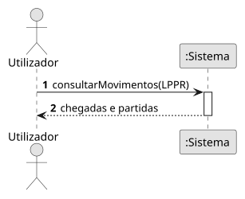

# US14 — Chegadas e partidas do LPPR

**Épico:** E3 · **Prioridade:** C · **SP:** 5 · **Estado:** ⏳ planeado para o Sprint 4

## User Story

> Como utilizador, quero ver as chegadas e partidas do aeroporto do Porto (LPPR).

## Critérios de Aceitação (proposta)

- A lista de chegadas inclui voos vistos com destino LPPR, com companhia, origem e hora estimada.
- A lista de partidas inclui voos vistos com origem LPPR que descolaram recentemente.
- Cada linha abre o painel do avião correspondente (US07).

> Critérios a validar no planeamento do Sprint 4; o desenho (SD) é feito nessa altura.

## Diagramas

- [SSD](puml/ssd_us14.puml) · 
- SD: a elaborar no planeamento do Sprint 4.
