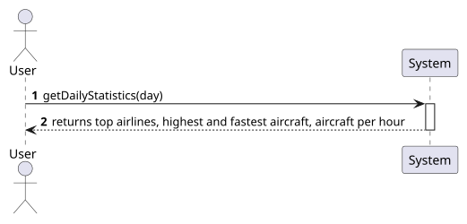

# US15 — Daily statistics

**Epic:** E3 · **Priority:** C · **SP:** 3 · **Status:** ⏳ planned for Sprint 4

## User Story

> As a user, I want daily statistics (top airlines, highest/fastest aircraft, peak hours).

## Acceptance Criteria (proposed)

- For a selected day, displays the top 10 airlines by number of flights.
- Displays the highest and fastest aircraft of the day.
- Displays the number of aircraft per hour (peak hours).
- Statistics use stored data (`position`, `receiver_snapshot`).

> Criteria to be validated during Sprint 4 planning; the design (SD) will be produced at that stage.

## Diagrams

- [SSD](puml/ssd_us15.puml) · 
- SD: to be produced during Sprint 4 planning.
