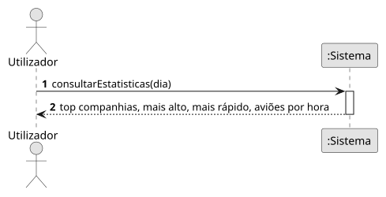

# US15 — Estatísticas diárias

**Épico:** E3 · **Prioridade:** C · **SP:** 3 · **Estado:** ⏳ planeado para o Sprint 4

## User Story

> Como utilizador, quero estatísticas diárias (top companhias, avião mais alto/rápido, horas de pico).

## Critérios de Aceitação (proposta)

- Para um dia escolhido, mostra o top 10 de companhias por número de voos.
- Mostra o avião mais alto e o mais rápido do dia.
- Mostra o número de aviões por hora (horas de pico).
- As estatísticas usam os dados guardados (`position`, `receiver_snapshot`).

> Critérios a validar no planeamento do Sprint 4; o desenho (SD) é feito nessa altura.

## Diagramas

- [SSD](puml/ssd_us15.puml) · 
- SD: a elaborar no planeamento do Sprint 4.
