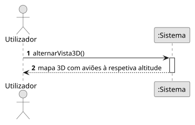

# US16 — Vista 3D

**Épico:** E3 · **Prioridade:** C · **SP:** 8 · **Estado:** ⏳ planeado para o Sprint 4

## User Story

> Como utilizador, quero uma vista 3D dos voos.

## Critérios de Aceitação (proposta)

- O mapa permite inclinação e rotação da câmara.
- Os aviões são desenhados à sua altitude, com o rasto em 3D.
- É possível alternar entre vista 2D e 3D sem perder a seleção.

> Critérios a validar no planeamento do Sprint 4; o desenho (SD) é feito nessa altura.

## Diagramas

- [SSD](puml/ssd_us16.puml) · 
- SD: a elaborar no planeamento do Sprint 4.
