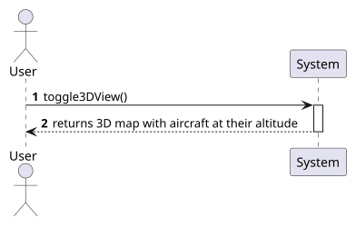

# US16 — 3D view

**Epic:** E3 · **Priority:** C · **SP:** 8 · **Status:** ⏳ planned for Sprint 4

## User Story

> As a user, I want a 3D view of flights.

## Acceptance Criteria (proposed)

- The map allows pitch and rotation of the camera.
- Aircraft are rendered at their altitude, with their track in 3D.
- It is possible to toggle between 2D and 3D views without losing the current selection.

> Criteria to be validated during Sprint 4 planning; the design (SD) will be produced at that stage.

## Diagrams

- [SSD](puml/ssd_us16.puml) · 
- SD: to be produced during Sprint 4 planning.
