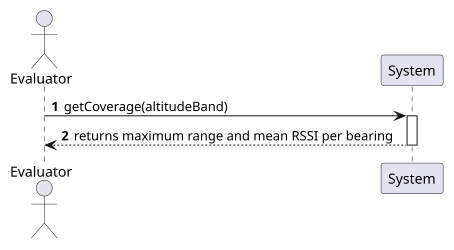

# US17 — Receiver coverage map

**Epic:** E4 · **Priority:** M · **SP:** 5 · **Status:** ⏳ planned for Sprint 3

## User Story

> As an evaluator, I want a receiver coverage map (range by bearing and RSSI) so that I can identify obstacles that attenuate or block the signal.

## Acceptance Criteria (proposed)

- Maximum range is calculated per azimuth sector (e.g. 1°) from received positions.
- The result is aggregated in a dedicated table that is not purged by retention.
- The map displays the range polygon and average RSSI per sector, optionally by altitude band.
- It is possible to identify sectors with abnormally reduced range (potential obstacles).

> Criteria to be validated during Sprint 3 planning; the design (SD) will be produced at that stage.

## Diagrams

- [SSD](puml/ssd_us17.puml) · 
- SD: to be produced during Sprint 3 planning.
