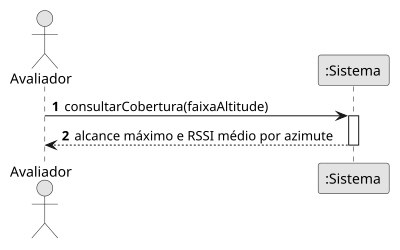

# US17 — Mapa de cobertura do recetor

**Épico:** E4 · **Prioridade:** M · **SP:** 5 · **Estado:** ⏳ planeado para o Sprint 3

## User Story

> Como avaliador, quero um mapa de cobertura do recetor (alcance por direção e RSSI) para identificar obstáculos que atenuam ou bloqueiam o sinal.

## Critérios de Aceitação (proposta)

- O alcance máximo é calculado por setor de azimute (p. ex. 1°) a partir das posições recebidas.
- O resultado é agregado numa tabela própria que não é apagada pela retenção.
- O mapa mostra o polígono de alcance e o RSSI médio por setor, opcionalmente por faixa de altitude.
- É possível identificar setores com alcance anormalmente reduzido (possíveis obstáculos).

> Critérios a validar no planeamento do Sprint 3; o desenho (SD) é feito nessa altura.

## Diagramas

- [SSD](puml/ssd_us17.puml) · 
- SD: a elaborar no planeamento do Sprint 3.
