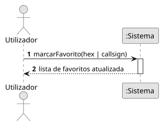

# US19 — Guardar favoritos

**Épico:** E5 · **Prioridade:** C · **SP:** 2 · **Estado:** ⏳ planeado para o Sprint 4

## User Story

> Como utilizador, quero guardar voos ou aviões favoritos.

## Critérios de Aceitação (proposta)

- É possível marcar/desmarcar um avião (hex) ou voo (callsign) como favorito.
- Os favoritos persistem no dispositivo.
- Os favoritos visíveis são destacados no mapa e listados num painel próprio.

> Critérios a validar no planeamento do Sprint 4; o desenho (SD) é feito nessa altura.

## Diagramas

- [SSD](puml/ssd_us19.puml) · 
- SD: a elaborar no planeamento do Sprint 4.
