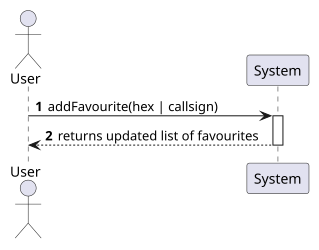

# US19 — Save favourites

**Epic:** E5 · **Priority:** C · **SP:** 2 · **Status:** ⏳ planned for Sprint 4

## User Story

> As a user, I want to save favourite flights or aircraft.

## Acceptance Criteria (proposed)

- It is possible to mark/unmark an aircraft (hex) or flight (callsign) as a favourite.
- Favourites persist on the device.
- Visible favourites are highlighted on the map and listed in a dedicated panel.

> Criteria to be validated during Sprint 4 planning; the design (SD) will be produced at that stage.

## Diagrams

- [SSD](puml/ssd_us19.puml) · 
- SD: to be produced during Sprint 4 planning.
