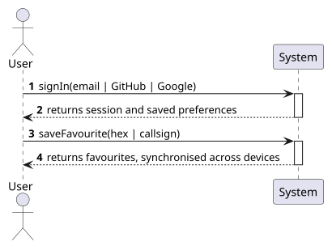

# US20 — User accounts and sign-in

**Epic:** E5 · **Priority:** C · **SP:** 8 · **Status:** 🔮 future (after the course delivery)

## User Story

> As a user, I want to create an account and sign in so that my favourites, alerts and preferences follow me across devices.

## Acceptance Criteria (proposed)

- A user can sign up and sign in with email (magic link or password) and with a GitHub or Google account.
- Favourites (US19), alert rules (US13) and preferences such as the map theme are stored per account and synchronised between web, Android and iOS.
- Without an account the application keeps working as today: the map, panels, track and replay remain public, and preferences are kept on the device.
- A user can sign out and delete the account and all its data.
- Each user can only read and change their own data.

## Design Notes

- Supabase Auth, already part of the stack, provides email and social sign-in; per-user tables are protected with row level security policies (`user_id = auth.uid()`).
- Public flight data does not depend on the account: the Worker API stays read-only and anonymous.

> Criteria to be validated if the story is planned; the design (SD) will be produced at that stage.

## Diagrams

- [SSD](puml/ssd_us20.puml) · 
- SD: to be produced when the story is planned.
